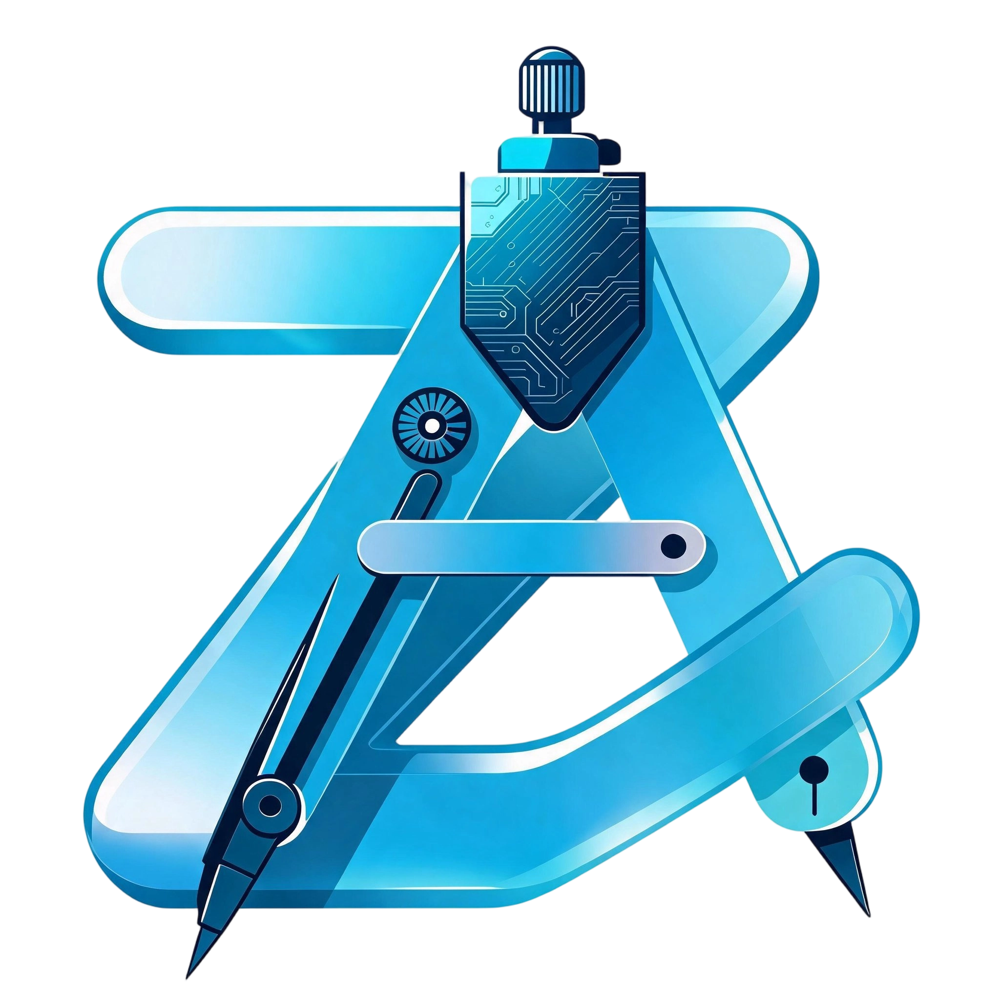

  

<h2 align="center"><b>ZeroStudio</b></h2>

  An IDE to develop real, Gradle-based Android applications on Android devices.

 

<!-- Latest release -->

<!-- Build and test -->

<!-- CodeFactor -->

<!-- Crowdin -->

<!-- License -->

  <a href="https://docs.ZeroStudio.com/">Explore the docs »</a> &nbsp; &nbsp;

## Features

- [x] Gradle support.
- [x] `JDK 11` and `JDK 17` available for use.
- [x] Terminal with necessary packages.
- [x] Custom environment variables (for Build & Terminal).
- [x] SDK Manager (Available via terminal).
- [x] API information for classes and their members (since, removed, deprecated).
- [x] Log reader (shows your app's logs in real-time)
- [ ] Language servers
    - [x] Java
    - [x] XML
    - [x] Kotlin
    - [ ] lua 
    - [ ] cmake 
    - [ ] c/c++/obj-c/obj-c++
    - [ ] web （html，css...)
    - [x] toml
    - [ ] python
    - [ ] shell
    - [ ] more.....
- [ ] UI Designer
    - [x] Layout inflater
    - [x] Resolve resource references
    - [x] Auto-complete resource values when user edits attributes using the attribute editor
    - [x] Drag & Drop
    - [x] Visual attribute editor
    - [x] Android Widgets
    - [ ] Implement a gripper constraint layout similar to Android studio
- [ ] String Translator
- [ ] Asset Studio (Drawable & Icon Maker)
- [x] (Git)[https://github.com/catpuppyapp/PuppyGit] 
- [ ] git CD/CI/PR/workflow container
- [x] (Chat ai)[https://github.com/rikkahub/rikkahub] Support assistant skills, tts ， mcp， Numerous common provider models etc...
- [ ] Preview function
    - [x] AndroidX Jetpack Compose Preview 
    - [x] images Preview
    - [x] Markdown preview
    - [ ] web(html，vue，nodejs，js，etc ...) preview
    - [ ] C/C++ drawing preview
    - [ ] flutter preview
    - [ ] More waiting ...
- [x] Built in Kotlin+JSON written MCP server, tools can be freely defined
- [x] Regular expression preview

To make your Markdown document look more professional and user-friendly (perfect for a GitHub README), I have added formatting elements like tables, blockquotes, and code blocks.

Here is the decorated version:

---
## ⚡️Offline SDK build tool installation package download channel(离线sdk构建工具安装包下载渠道)
[github Release page](https://github.com/msmt2018/SDK-tool-for-Android-platform/releases/tag/ZeroStudio_OfflineResourceInstallationPackage)

[gitee Release page](https://gitee.com/android-zero/ZeroStudio-sdkbuildtool/releases/tag/ZeroStudio-sdk%E6%9E%84%E5%BB%BA%E5%B7%A5%E5%85%B7%E7%A6%BB%E7%BA%BF%E5%AE%89%E8%A3%85%E5%8C%85)

[Google Drive](https://drive.google.com/file/d/1jiFzQXD1HXwzr3zDrYVlGqYxOjua0QMH/view?usp=drive_link)

---

## Installation

> _Please install ZeroStudio from trusted sources only i.e._
> - [_GitHub Releases_](https://github.com/msmt2018/ZeroStudio/releases)
> - [_GitHub Actions_](https://github.com/msmt2018/ZeroStudio/actions?query=branch%3Adev+event%3Apush)
<!-- > - [_F-Droid_](https://f-droid.org/packages/com.itsaky.ZeroStudio/) -->

- Download the ZeroStudio APK from the mentioned trusted sources.
- Follow the
  instructions [here](https://docs.ZeroStudio.com/tutorials/get-started.html) to
  install the build tools.

## Limitations

- For working with projects in ZeroStudio, your project must use Android Gradle Plugin v7.2.0 or
  newer. Projects with older AGP must be migrated to newer versions.
- SDK Manager is already included in Android SDK and is accessible in ZeroStudio via its Terminal.
  But, you cannot use it to install some tools (like NDK) because those tools are not built for
  Android.
- No official NDK support because we haven't built the NDK for Android.

The app is still being developed actively. It's in beta stage and may not be stable. if you have any
issues using the app, please let us know.

## Contributing

See the [contributing guide](./CONTRIBUTING.md).

For translations, visit the [Crowdin project page](https://crowdin.com/project/zerosrudio).

## Disclaimer

ZeroStudio is a general-purpose Android development environment. It is provided
under the licenses applicable to each individual source file and component.
This repository contains original ZeroStudio work, AndroidIDE-derived work,
and other third-party components; it is not a single uniformly licensed work.

Users are responsible for the software they create, build, modify, or distribute
with ZeroStudio, including compliance with the licenses and laws applicable to
that software and to any third-party components they use.

---

## License

<strong>📜 ZeroStudio License & Legal Terms — Three-License Combination</strong>

### 📜 License Overview

**ZeroStudio original project code** that is owned by the relevant copyright holder or is otherwise properly authorized is released under a combination of these three open-source licenses:

1. **GNU Affero General Public License v3.0 only** — AGPL-3.0-only
2. **GNU General Public License v3.0 only** — GPL-3.0-only
3. **Apache License 2.0** — Apache-2.0

The project's combined SPDX license expression is:

~~~text
SPDX-License-Identifier: AGPL-3.0-only AND GPL-3.0-only AND Apache-2.0
~~~

**Important — the meaning of AND:** The SPDX operator AND means that all three listed licenses apply cumulatively to a file carrying this exact expression. It is **not** an OR choice, does not let a recipient select only one of the three licenses, and does not mean that the repository offers three alternative licensing options. The applicable terms of all three license texts must be read together.

### 📚 What the Three Licenses Cover

| License | Main subject and obligations |
| --- | --- |
| **GNU AGPL v3.0 only** | Based on GPL v3, with additional source-code offer requirements for certain modified versions that interact with users over a network. Whether the requirements apply depends on the circumstances described in the AGPL text. |
| **GNU GPL v3.0 only** | Grants rights to run, study, modify, and redistribute covered software. Distribution of covered works and modified versions is subject to the license's conditions, including applicable source-code, notice, and same-license requirements. |
| **Apache License 2.0** | Provides broad rights to use, modify, and distribute covered works, and includes an express patent license. Redistribution remains subject to its applicable copyright, license-copy, modification-notice, patent, and NOTICE requirements. |

This table is an informational summary only. It does not replace, narrow, or override
the actual license texts. For the precise scope and conditions of each license, consult
the complete texts linked below.

### 📄 Full License Texts

- [GNU Affero General Public License v3.0 only — AGPL-3.0-only](./LICENSE-AGPL-3.0-only.txt)
- [GNU General Public License v3.0 only — GPL-3.0-only](./LICENSE-GPL-3.0-only.txt)
- [Apache License 2.0 — Apache-2.0](./LICENSE-Apache-2.0.txt)

### 🧭 Scope of This License Group

The three-license combination is **not a blanket relicensing of every file in this Git repository**. It applies to an original work only where the relevant copyright holder owns or has obtained the necessary rights to license that work and the file is expressly marked with the combined SPDX expression:

~~~text
SPDX-License-Identifier: AGPL-3.0-only AND GPL-3.0-only AND Apache-2.0
~~~

The following file-level boundaries apply:

1. **Original ZeroStudio code:** Original code created by the project author and properly controlled or authorized by the relevant rights holder may use the three-license expression above.
2. **AndroidIDE-derived code:** Code inherited, copied, or modified from AndroidIDE remains subject to its applicable upstream license and copyright notices. Its presence in this repository does not automatically place it under the ZeroStudio three-license group.
3. **Other third-party components:** Code originating from RikkaHub, PuppyGit, Termux, Tree-sitter, libgit2, Sora Editor, Eclipse, or other third-party projects remains subject to its own applicable license, copyright notices, and NOTICE requirements.
4. **Files containing mixed-origin code:** Upstream notices and license terms must be preserved. The entire file must not be relabeled under the three-license group unless all necessary rights and permissions have been obtained. Where appropriate, identify ZeroStudio's own modifications separately.
5. **Files without a clear license notice:** The absence of a license header does not by itself establish that a file belongs to ZeroStudio or is covered by the three-license group. Its origin, copyright ownership, and licensing authority must be checked before adding or changing a license notice.

### 💼 Commercial Use and Distribution

The three licenses named above are open-source licenses and **this project does not add a blanket non-commercial restriction** to works validly covered by the combined SPDX expression.

Commercial use, commercial modification, and commercial distribution are not prohibited merely because the code belongs to ZeroStudio. They must, however, comply with **all applicable conditions** of AGPL-3.0-only, GPL-3.0-only, and Apache-2.0, as well as any separate license terms that apply to third-party components.

In particular:

- Do not remove or misrepresent applicable copyright, license, attribution, modification, or NOTICE information.
- When distributing covered binaries or modified works, satisfy the corresponding source-code and license obligations that apply under the relevant license texts.
- Where the AGPL network-interaction provisions apply to a modified covered version, comply with those provisions.
- Respect the separate licenses of upstream and third-party components; this README does not grant rights that their copyright holders have not granted.

### ✍️ Copyright, Author Attribution, and Contributions

Project attribution and file copyright ownership are related but distinct:

- Original ZeroStudio main-source files may identify the project with **Project: ZeroStudio** while retaining the actual author and copyright information.
- A contributor fixing a bug or modifying an existing file should preserve its existing author, copyright, SPDX, and upstream license notices. The contributor may record their own name or ID and the exact change in a nearby comment where appropriate, a change log, commit, or Pull Request.
- A contributor creating a new source file may provide their own author and copyright notice based on the actual authorship. The file may also include **Project: ZeroStudio** to identify its project affiliation.
- A contribution being merged into ZeroStudio does not, by itself, transfer the contributor's copyright to the project author or to the project.
- A newly created file may use the combined three-license SPDX expression only when the contributor has the necessary rights and has expressly authorized that licensing.

See [协议.md](./协议.md) for the detailed rules on project attribution, existing-file modifications, new contributor files, authorization, and third-party attribution.

### 🛡️ Independent Works and Responsibility

ZeroStudio is a general-purpose development environment. Applications, libraries, source code, and other works that users independently create, build, or generate with the IDE remain the responsibility of their respective authors and distributors.

The inclusion of a tool or component in ZeroStudio does not mean that the ZeroStudio project endorses, controls, or assumes responsibility for independently created user projects. Users must assess and comply with the licenses and legal requirements applicable to the dependencies and outputs they choose to use or distribute.

### 📂 License and Legal Reference Files

- [LICENSE](./LICENSE) — repository-level license notice and file-level license index.
- [协议.md](./协议.md) — detailed license scope, third-party boundaries, copyright ownership, and contributor attribution policy.
- [COPYRIGHT_HEADER.txt](./COPYRIGHT_HEADER.txt) — source-file copyright header template.
- [AGPL-3.0-only full text](./LICENSE-AGPL-3.0-only.txt)
- [GPL-3.0-only full text](./LICENSE-GPL-3.0-only.txt)
- [Apache-2.0 full text](./LICENSE-Apache-2.0.txt)

### ⚖️ Legal Interpretation and No Additional Restrictions

This README section is an explanatory project notice, not a separate custom license and not a substitute for the complete license texts. It does not create additional restrictions or permissions beyond those validly granted by the relevant copyright holders.

The former **ZeroStudio Community License (ZSCL)** and its custom terms have been withdrawn. They are not part of the current three-license combination and must not be treated as additional conditions on works covered by the current SPDX expression.

For any particular file, the controlling information is its valid file-level license notice, the rights held by the relevant copyright holder, applicable upstream notices, and the complete license text. Nothing in this README relicenses third-party works or overrides their original terms.

**[📄 View the repository LICENSE notice](./LICENSE)** · **[📜 Read the detailed license and copyright policy](./协议.md)**

## Contact the author of ZeroStudio

- Email: 2049219004@qq.com
- WeChat: android_zero
