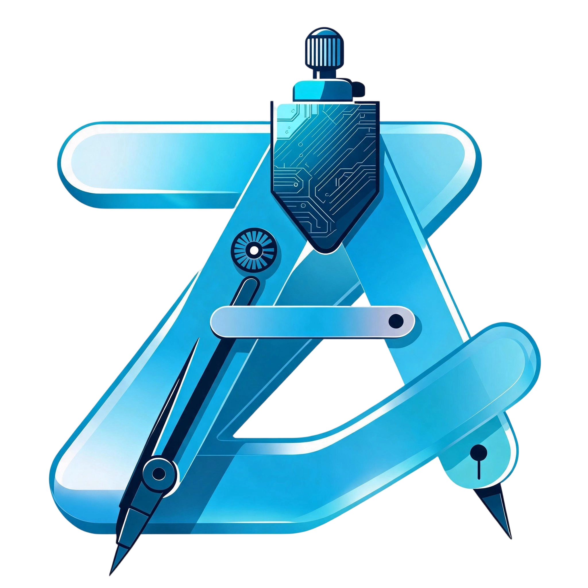

<p align="center">
  
</p>

<h2 align="center"><b>ZeroStudio</b></h2>
<p align="center">
  An IDE to develop real, Gradle-based Android applications on Android devices.
</p><br>

<p align="center">
<!-- Latest release -->

<!-- Build and test -->

<!-- CodeFactor -->

<!-- Crowdin -->
<a href="https://crowdin.com/project/ZeroStudio"></a>
<!-- License -->
</p>

<p align="center">
  <a href="https://docs.ZeroStudio.com/">Explore the docs »</a> &nbsp; &nbsp;
</p>


## Features

- [x] Gradle support.
- [x] `JDK 11` and `JDK 17` available for use.
- [x] Terminal with necessary packages.
- [x] Custom environment variables (for Build & Terminal).
- [x] SDK Manager (Available via terminal).
- [x] API information for classes and their members (since, removed, deprecated).
- [x] Log reader (shows your app's logs in real-time)
- [ ] Language servers
    - [x] Java
    - [x] XML
    - [x] Kotlin
    - [ ] lua 
    - [ ] cmake 
    - [ ] c/c++/obj-c/obj-c++
    - [ ] web （html，css...)
    - [x] toml
    - [ ] python
    - [ ] shell
    - [ ] more.....
- [ ] UI Designer
    - [x] Layout inflater
    - [x] Resolve resource references
    - [x] Auto-complete resource values when user edits attributes using the attribute editor
    - [x] Drag & Drop
    - [x] Visual attribute editor
    - [x] Android Widgets
    - [ ] Implement a gripper constraint layout similar to Android studio
- [ ] String Translator
- [ ] Asset Studio (Drawable & Icon Maker)
- [x] (Git)[https://github.com/catpuppyapp/PuppyGit] 
- [ ] git CD/CI/PR/workflow container
- [x] (Chat ai)[https://github.com/rikkahub/rikkahub] Support assistant skills, tts ， mcp， Numerous common provider models etc...
- [ ] Preview function
    - [x] AndroidX Jetpack Compose Preview 
    - [x] images Preview
    - [x] Markdown preview
    - [ ] web(html，vue，nodejs，js，etc ...) preview
    - [ ] C/C++ drawing preview
    - [ ] flutter preview
    - [ ] More waiting ...
- [x] Built in Kotlin+JSON written MCP server, tools can be freely defined
- [x] Regular expression preview

To make your Markdown document look more professional and user-friendly (perfect for a GitHub README), I have added formatting elements like tables, blockquotes, and code blocks.

Here is the decorated version:

---
## ⚡️Offline SDK build tool installation package download channel(离线sdk构建工具安装包下载渠道)
[github Release page](https://github.com/msmt2018/SDK-tool-for-Android-platform/releases/tag/ZeroStudio_OfflineResourceInstallationPackage)

[gitee Release page](https://gitee.com/android-zero/ZeroStudio-sdkbuildtool/releases/tag/ZeroStudio-sdk%E6%9E%84%E5%BB%BA%E5%B7%A5%E5%85%B7%E7%A6%BB%E7%BA%BF%E5%AE%89%E8%A3%85%E5%8C%85)

[Google Drive](https://drive.google.com/file/d/1jiFzQXD1HXwzr3zDrYVlGqYxOjua0QMH/view?usp=drive_link)

---

## Installation
[](https://github.com/msmt2018/ZeroStudio/releases)

> _Please install ZeroStudio from trusted sources only i.e._
> - [_GitHub Releases_](https://github.com/msmt2018/ZeroStudio/releases)
> - [_GitHub Actions_](https://github.com/msmt2018/ZeroStudio/actions?query=branch%3Adev+event%3Apush)
<!-- > - [_F-Droid_](https://f-droid.org/packages/com.itsaky.ZeroStudio/) -->

- Download the ZeroStudio APK from the mentioned trusted sources.
- Follow the
  instructions [here](https://docs.ZeroStudio.com/tutorials/get-started.html) to
  install the build tools.

## Limitations

- For working with projects in ZeroStudio, your project must use Android Gradle Plugin v7.2.0 or
  newer. Projects with older AGP must be migrated to newer versions.
- SDK Manager is already included in Android SDK and is accessible in ZeroStudio via its Terminal.
  But, you cannot use it to install some tools (like NDK) because those tools are not built for
  Android.
- No official NDK support because we haven't built the NDK for Android.

The app is still being developed actively. It's in beta stage and may not be stable. if you have any
issues using the app, please let us know.

## Contributing

See the [contributing guide](./CONTRIBUTING.md).

For translations, visit the [Crowdin project page](https://crowdin.com/project/zerosrudio).

<details close>
<summary>⚖️ <strong>🍀 Core projects referenced in project integration</strong></summary>

## Thank you to the developers for their outstanding contributions to open source.
-> The order of arrangement is not important.

 - [x] (sora editor)[https://github.com/Rosemoe/sora-editor]
 - [x] (PuppyGit)[https://github.com/catpuppyapp/PuppyGit]
 - [x] (rikkahub)[https://github.com/rikkahub/rikkahub] 
 - [x] (termux)[https://github.com/termux/termux-app]

## Thanks to

- **[AndroidIDE](https://github.com/AndroidIDEOfficial/AndroidIDE)** by **[itsaky](https://github.com/itsaky)** and **[AndroidIDEOfficial](https://github.com/AndroidIDEOfficial)** for the original project foundation.
- [Rosemoe](https://github.com/Rosemoe) for the awesome [CodeEditor](https://github.com/Rosemoe/sora-editor)
- [Termux](https://github.com/termux) for [Terminal Emulator](https://github.com/termux/termux-app)
- [Bogdan Melnychuk](https://github.com/bmelnychuk) for [AndroidTreeView](https://github.com/bmelnychuk/AndroidTreeView)
- [George Fraser](https://github.com/georgewfraser) for the [Java Language Server](https://github.com/georgewfraser/java-language-server)
- [Vivek](https://github.com/itsvks19) for [LayoutEditor](https://github.com/itsvks19/LayoutEditor)
- [catpuppyapp](https://github.com/catpuppyapp) for [PuppyGit](https://github.com/catpuppyapp/PuppyGit)
- [rikkahub](https://github.com/rikkahub) for [Rikkahub](https://github.com/rikkahub/rikkahub)

Thanks to all the developers who have contributed to this project.
</details>


## Contact Us
- [Telegram channel](https://t.me/android_zero_studio)
- [Tencent QQ group](https://qm.qq.com/q/FjC6t6XSsU)

<p align="center">
  <a href="https://github.com/msmt2018/ZeroStudio/issues/new?labels=bug&template=BUG.yml&title=%5BBug%5D%3A+">Report a bug</a> &nbsp; &#8226; &nbsp;
  <a href="https://github.com/msmt2018/ZeroStudio/issues/new?labels=feature&template=FEATURE.yml&title=%5BFeature%5D%3A+">Request a feature</a> &nbsp; &#8226; &nbsp;
</p>


<details close>
<summary>⚖️ <strong>IMPORTANT DISCLAIMER / 重要免责声明 (CLICK TO READ)</strong></summary>

### 🛡️ Legal Disclaimer & Liability Waiver (免责声明与责任豁免)

> [!CAUTION]
> **CRITICAL NOTICE: PLEASE READ CAREFULLY BEFORE USE**
> **重要通告：请在使用前仔细阅读本条款，使用本软件即代表您完全接受以下内容**

#### 1. Neutrality of Tool (工具中立性与责任切割)
*   **CN:** `ZeroStudio` 仅作为一款通用集成开发环境（IDE）提供，属于技术生产力工具。**任何使用本 IDE 构建、编译、生成的软件项目、代码或应用程序，均属于用户的个人行为，与 `ZeroStudio` 开源项目、维护团队及贡献者（下称“我们”）完全无关。** 我们不对用户开发的内容、功能、安全性或合法性承担任何明示或暗示的担保或连带责任。
*   **EN:** `ZeroStudio` is provided solely as a general-purpose Integrated Development Environment (IDE) and is a technical productivity tool. **Any software projects, code, or applications built, compiled, or generated using this IDE are the sole acts of the user and are completely independent of the `ZeroStudio` open-source project, its maintenance team, and contributors (hereinafter "We").** We assume no express or implied warranty or joint liability for the content, functionality, security, or legality of what users develop.

#### 2. Strict Prohibition of Malicious Use (严禁恶意用途)
*   **CN:** 严禁使用 `ZeroStudio` 编写、构建或传播任何**恶意代码（Malware）**或用于**非法用途**。
    *   **禁止范围包括但不限于**：勒索软件（Ransomware）、特洛伊木马（Trojans）、计算机病毒、网络蠕虫、间谍软件、僵尸网络控制端、DDOS 攻击工具、非法渗透/入侵工具、流量劫持软件、以及任何旨在窃取数据、破坏计算机系统、损坏硬件设备或干扰网络正常运行的程序。
    *   **后果**：任何利用本工具进行上述违规开发的行为，其后果完全由使用者自行承担，与本项目及开发者无关。
*   **EN:** It is strictly prohibited to use `ZeroStudio` to write, build, or distribute any **Malicious Code** or for any **Illegal Purposes**.
    *   **Prohibited acts include but are not limited to**: Ransomware, Trojans, Computer Viruses, Worms, Spyware, Botnet controllers, DDoS attack tools, Illegal Penetration/Hacking tools, Traffic Hijacking software, and any program intended to steal data, damage computer systems, brick hardware devices, or disrupt network operations.
    *   **Consequences**: The consequences of any such non-compliant development using this tool shall be borne solely by the user This has nothing to do with this project or its developers.。

#### 3. Legal Compliance & Indemnification (法律合规与赔偿)
*   **CN:** 用户必须承诺在**遵守当地国家/地区法律法规**（包括但不限于《中华人民共和国网络安全法》、《计算机信息系统安全保护条例》等）的前提下使用本工具。
    *   **独担责任**：因用户使用本 IDE 开发的软件导致任何第三方损失、法律纠纷或行政处罚，**全部法律责任与赔偿责任由用户独立承担**。
    *   **无关联声明**：项目作者 `github/msmt2018(android_zero）` 及所有贡献者不对用户的任何违法行为背书，亦不承担任何法律责任。
*   **EN:** Users must commit to using this tool in full **compliance with local/national laws and regulations** (e.g., Cybersecurity Laws, Computer Fraud and Abuse Acts).
    *   **Sole Liability**: The user assumes **full legal and indemnification liability** for any third-party losses, legal disputes, or administrative penalties caused by software developed using this IDE.
    *   **Non-Affiliation**: The project author `github/msmt2018(android_zero）` and all contributors do not endorse any illegal acts by users and assume no legal liability whatsoever.

> [!NOTE]
> **Transparency Statement / 透明化声明**
> This project is 100% open-source and transparent. The code is available for public audit to prove it contains no built-in malice. Users are responsible for their own creations.
> 本项目保持 100% 开源透明，代码接受公众审计以证明不包含内置恶意功能。用户需对其创造的内容全权负责。


</details>

## License


```
## 📜 License & Legal Terms

**ZeroStudio** is released under the **GNU GPLv3 License with Mandatory Additional Terms**.
While preserving the core spirit of open source under GNU GPLv3, this project incorporates **legally binding non-permissions and restrictions** pursuant to **Section 7 (Additional Terms)** of the GNU GPLv3 license.

> 🛑 **CRITICAL WARNING**
>
> Under Section 7 of the GNU GPLv3, **any form of commercial usage, commercialization, or unauthorized monetization of this project or its source code is STRICTLY PROHIBITED**. Any attempt to remove or circumvent these additional commercial restrictions via standard GPLv3 loopholes is expressly voided.

---

### 🚫 Prohibited Actions & Commercial Restrictions

Without explicit, prior written permission or formal authorization from the developer (`@author android_zero（github.com/msmt2018)`), any individual, organization, corporation, or team is **STRICTLY PROHIBITED** from executing the following actions. Violations will result in immediate termination of all usage rights and may incur legal liabilities:

1. **No Commercial Project Integration:**
   * **Strictly Prohibited** to integrate any source code, specific files, code snippets, or project modules (including but not limited to APK build outputs, components, and libraries) from this project into any commercial, proprietary, or revenue-generating software or services.

2. **No Commercialization or Monetization of ZeroStudio:**
   * **Strictly Prohibited** to rebrand, repackage, redistribute, or sell this project or any of its derivatives as a commercial product.
   * **Strictly Prohibited** to inject commercial advertisements, paywalls, pop-ups, or any user-experience-harming monetization trackers into the open-source code, the official APK, or any forked variants.

3. **No Unauthorized Paid Features:**
   * This project is completely free. Except for voluntary donations via GitHub Sponsors or other officially designated developer donation channels, **no one is permitted to add built-in paid features, activation keys, pay-to-unlock mechanisms, premium tier limits, or in-app purchase modules** into the ZeroStudio source files or compiled APK packages.

4. **Malicious Code & Security Red Lines:**
   * **Strictly Prohibited** to inject any malicious payload, including crypto-miners, Trojans, ransomware, phishing scripts, backdoors, or code that unauthorizedly modifies devices or damages other people's systems.
   * Any specific feature modification within safe/legal bounds that might involve high-risk permissions or operations **must** be submitted as a formal proposal in the GitHub Issues or Discussions section and receive explicit approval from the developer.

---

### ✅ User Freedoms & Requirements

Subject to strict adherence to the [Commercial Restrictions] and [Security Red Lines] above, you enjoy the fundamental freedoms granted by GNU GPLv3:

* **Free for Personal Use:** You are fully allowed to use this software for personal learning, educational purposes, academic research, or internal non-profit utilities completely free of charge.
* **Freedom to Modify & Fork:** You are free to modify, fork, or redistribute the code, provided that any derivative work **remains 100% open source** (closed-source distribution is explicitly prohibited).
* **Attribution Required:** You **must** retain the original author attribution (`@author android_zero` and contributors) prominently across all modified or redistributed source files.

---

<summary><strong>⚖️ Detailed Legal Constraints & Compliance Note</strong></summary>

### 1. GNU GPLv3 Section 7 Compliance
In accordance with Section 7 of the GNU General Public License v3, the copyright holder reserves the right to supplement standard license terms with reasonable restrictions. The "Commercial Prohibition" and "Fee Restriction" enforced here are legal reservations of the author's copyright. Any modification, redistribution, or derivation of this repository must inherit these terms unconditionally.

### 2. Independent Creation & Liability Disclaimer
As a general-purpose Integrated Development Environment (IDE), any third-party projects, source codes, or applications built, compiled, or generated using ZeroStudio are the sole creation and responsibility of the user. The ZeroStudio team and the original author do not endorse, manage, or assume any joint liability for what users build.


```
<details open>

<summary><strong>⚖️ Detailed Legal Constraints & Compliance Note</strong></summary>

### 1. GNU GPLv3 Section 7 Compliance
In accordance with Section 7 of the GNU General Public License v3, the copyright holder reserves the right to supplement standard license terms with reasonable restrictions. The "Commercial Prohibition" and "Fee Restriction" enforced here are legal reservations of the author's copyright. Any modification, redistribution, or derivation of this repository must inherit these terms unconditionally.

**[📄 Click here to view the full LICENSE file](./LICENSE)**

</details>

## Contact the author of ZeroStudio:
* Tencent, China QQ Email：2049219004@qq.com (Commonly used)
* Tencent QQ account in China：2049219004
* Tencent WeChat account in China：android_zero

Any violations to the license can be reported either by opening an issue or writing a mail to us
directly.


