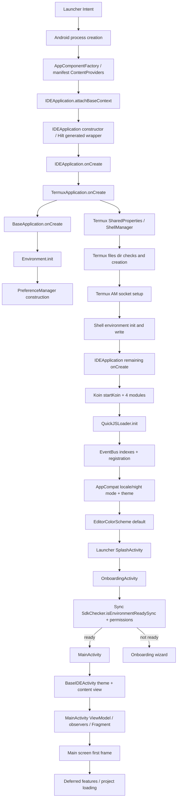
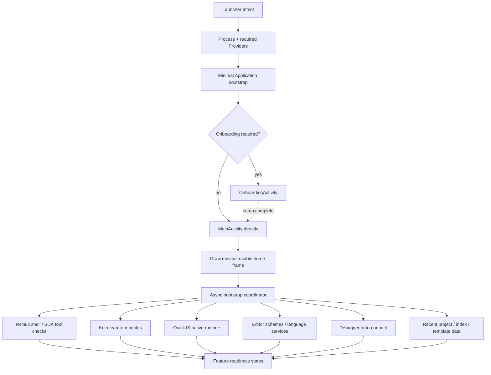

# ZeroStudio 冷启动链路审查与性能优化方案

> 审查基线：GitHub 默认分支 `8c01bd143f53265b2023e4aa159166dc411b50a7`（本次源码检索时的 HEAD）。
> 范围：Launcher intent → Application / ContentProvider → SplashActivity → OnboardingActivity → MainActivity 首帧与可交互状态。
> 本文是静态源码审查结论和实施设计，不代表已经在真机上完成 Perfetto 归因或性能验证。

## 1. 结论摘要

当前冷启动存在多个可确认的额外工作阶段，不能将 0.2～2 秒的延迟简单归因于某一个 Splash Activity：

1. Launcher 当前指向 `SplashActivity`，它只负责启动 `OnboardingActivity`，随后立即 finish。它增加一次 Activity 创建/切换，不提供实际业务价值。
2. `OnboardingActivity.onCreate()` 与 `onResume()` 都会调用 `tryNavigateToMainIfSetupIsCompleted()`。该路径调用 `isSetupCompleted()`，其中同步执行 `SdkChecker.isEnvironmentReadySync()` 和权限检查。首次启动/环境已准备好的用户仍可能先进入 Onboarding，再做同步环境判定。
3. `IDEApplication` 继承 `TermuxApplication`，其 `super.onCreate()` 会继续执行 `BaseApplication.onCreate()` 和 Termux 初始化。Termux 路径包含 SharedPreferences、properties、shell manager、文件目录可访问性/创建、socket server、环境常量及环境文件写入；这些均发生在 Application 主线程生命周期内。
4. `IDEApplication.onCreate()` 继续在主线程启动 Koin 四组 modules、初始化 QuickJS native loader、安装 EventBus 多个索引、设置 AppCompat 夜间模式、读取主题并可能应用 DynamicColors、创建默认 EditorColorScheme。
5. `MainActivity` 继承链为 `MainActivity → EdgeToEdgeIDEActivity → IDEActivity → BaseIDEActivity → AppCompatActivity`。BaseIDEActivity 在 super.onCreate 前后重复调用 `IThemeManager.applyTheme(this)`，随后设置内容视图。MainActivity 又立即触发 ViewModel、Fragment transaction、Flow collector、last-project 检查及默认页面切换。
6. 主工程目前没有把面向 `:core:app` 的 Baseline Profile 测试模块接入根 `settings.gradle.kts`。仓库中存在的 `:core:chatai:app:baselineprofile` 目录是聊天模块模板遗留：其测试目标写为 `:app`，生成脚本等待 `chat_input` 并执行聊天发送流程，不是 ZeroStudio 主应用的 Launcher → MainActivity 用户旅程。

因此，优先级最高的不是先堆叠 Profile 规则，而是：移除无效 Activity 中转、把环境探测改为可缓存/异步、拆分 Application 初始化、保证 MainActivity 尽早画出稳定首帧，然后用 Macrobenchmark + Perfetto 找到剩余耗时。Baseline Profile 和 Startup Profile 是第二层优化，能减少启动热路径代码的解释/JIT/类加载布局成本，但不能消除文件 I/O、进程/系统调度、同步锁、磁盘等待或人为保持 Splash 的时间。

## 2. 当前实际启动链路

### 2.1 链路架构图（源码可确认部分）



说明：
- Android 会在 Application.onCreate 前创建最终合并 Manifest 中注册的 ContentProvider。当前仅凭 `core/app/src/main/AndroidManifest.xml` 不能代表最终 APK 的完整 Provider 列表；必须对 release APK 执行 manifest merger report / `apkanalyzer manifest print`，并检查所有依赖 AAR 的 Provider 初始化代码。
- 图中 Hilt generated wrapper 是由 `@HiltAndroidApp` 触发的 Application 包装/注入机制；是否有昂贵的 eager singleton 构造，必须结合 Hilt module 和启动 trace 验证，不能只看注解断言。
- 图中没有画出 Android Runtime、Zygote fork、类验证、资源加载、Dex/so linker、WindowManager、SurfaceFlinger 和首帧同步等系统步骤；它们也计入 TTID。

### 2.2 关键源码证据

| 节点 | 当前实现 | 性能风险 |
|---|---|---|
| Launcher | Manifest 的 MAIN/LAUNCHER 指向 `.activities.SplashActivity` | 额外 Activity 中转 |
| Splash | `installSplashScreen()` 后启动 OnboardingActivity | 不做路由决策或初始化，只增加切换 |
| Onboarding | onCreate、onResume 均尝试环境判定 | 同步环境检查可能触发文件/权限/SDK 探测 |
| BaseApplication | `Environment.init(this)`、创建 PreferenceManager | 需要拆分纯内存初始化与文件/目录初始化 |
| TermuxApplication | ShellManager、文件目录、socket、环境文件 | 启动关键路径上包含文件系统和进程/IPC 初始化 |
| IDEApplication | Koin、QuickJS、EventBus、Theme、EditorColorScheme | 主线程初始化面过宽 |
| BaseIDEActivity | Theme apply 在 super.onCreate 前后各执行一次 | 重复主题应用；需确认调用副作用 |
| MainActivity | ViewModel、Fragment、Flow、自动检查最近项目 | 首帧之前不应执行非首屏必需工作 |
| Baseline Profile | 现有 profile 目录位于 chatai/app 子目录 | 当前测试旅程和 targetProjectPath 不对应主应用 |

### 2.3 Application 阶段必须进一步量化的具体项目

`IDEApplication.onCreate()` 的计时日志目前只记录整个 onCreate 总耗时。它无法定位是 `super.onCreate()`、Koin、QuickJS、EventBus 还是主题系统造成延迟。必须增加分段 trace：

- `IDEApplication.attachBaseContext`：Locale preference 读取和 LocaleProvider 查询。
- `BaseApplication.onCreate`：Environment.init、PreferenceManager。
- `TermuxApplication.onCreate`：按每个方法记录耗时，特别是目录创建、socket server、环境文件写入。
- `IDEApplication.onCreate`：Koin module 注册、QuickJSLoader、EventBus、AppCompat、DynamicColors、EditorColorScheme。
- 所有合并 Manifest Provider 的 `onCreate()`：逐个统计耗时与线程。
- Hilt eager singleton / ContentProvider initializer / WorkManager initializer：通过 Perfetto 和启动日志识别真实执行位置。

不得把所有工作简单挪进一个 IO coroutine 后就宣称完成优化：依赖关系、首次使用时序、失败处理、重复初始化、进程重启和 Service/Provider 先于 UI 访问全局状态等都必须保持正确。

## 3. 白屏和启动 Logo 长时间停留的原因分类

### 3.1 白屏

优先排查以下路径：

1. Splash theme 的 windowBackground 与系统 SplashScreen 背景/图标是否一致；启动窗口先显示主题背景，目标 Activity theme 不一致时会出现白色闪帧。
2. SplashActivity → OnboardingActivity → MainActivity 连续启动/finish，导致窗口切换时出现背景暴露或短暂空窗。
3. OnboardingActivity 调用 `IThemeManager.applyTheme(this)` 后才进入 AppIntro2 super 初始化，检查主题、资源和窗口背景是否在每次启动一致。
4. MainActivity 首次内容为空：`BaseIDEActivity.setContentView(bindLayout())` 先创建 FrameLayout，Fragment transaction 使用 `commitAllowingStateLoss()` 异步提交；首帧时可能尚未显示 MainFragment。
5. MainFragment 首屏若在首次 composition / view inflation 执行同步磁盘、数据库、模板、项目索引或大资源解析，也会造成空白或首帧延迟。
6. SplashScreen API 的 `setKeepOnScreenCondition` 如果存在于其他主题/Activity 代码中，条件必须 O(1) 且不能在 UI 线程做磁盘/SDK 检查。当前已查看的 SplashActivity 没有设置该条件。

### 3.2 Logo / Splash 停留时间

系统 Splash 会覆盖启动 Activity 的首帧，进程/Application/Provider 初始化慢时，Logo 自然会持续显示。它并不一定是 Splash 动画本身慢。

禁止通过设置固定长动画、`setKeepOnScreenCondition { true }`、Thread.sleep、同步等待后台任务来掩盖延迟。Splash 只应覆盖应用确实尚未画出第一帧的短暂窗口。

## 4. 推荐的目标架构

### 4.1 新启动链路



### 4.2 必须遵守的启动分层

**S0：进程与 Provider**
- 只保留系统/第三方库确实要求在 Application.onCreate 前完成的 Provider。
- 检查 Firebase、WorkManager、App Startup、Shizuku、DocumentsProvider 等所有合并 Manifest 组件。
- 禁止在 Provider 构造或 onCreate 做目录扫描、SDK 检测、网络请求、启动 shell 或初始化完整语言服务。
- 对确实需要自动初始化的库，评估 manifest metadata 关闭自动初始化并改为延迟手动初始化；先验证 SDK 文档和调用时序。

**S1：最小 Application bootstrap**
- 建立进程级轻量容器：Application 引用、崩溃处理、基础 Locale/Theme 配置、线程池/调度器入口。
- 仅执行无法延迟且必须先于首屏的工作。
- 不启动 Termux shell 环境文件写入、不扫描 SDK/JDK、不启动语言服务、不初始化 QuickJS、不加载编辑器全套配色。
- 使用显式状态机保证初始化幂等：NOT_STARTED → INITIALIZING → READY / FAILED；失败可重试且不能让 UI 永久等待。

**S2：Activity 与首帧**
- Manifest Launcher 只保留真正的路由入口；已完成引导直接 MainActivity，未完成引导直接 OnboardingActivity。
- 不再使用仅用于 startActivity + finish 的 SplashActivity。
- MainActivity 第一帧只构建导航骨架、标题/工具栏、空态/最近项目占位和必要交互。
- 避免首帧前等待数据库、模板索引、项目扫描、Termux shell、Koin feature graph、QuickJS。
- 首屏状态由异步任务逐步填充，避免空白页面。

**S3：后台 Feature bootstrap**
- Termux 环境：在用户进入终端/构建/需要 shell 的功能之前异步准备；文件目录权限与失败状态明确展示。
- Koin：拆成基础模块与 ChatAI 功能模块。只在 ChatAI 功能首次打开前启动 ChatAI 模块，确保没有其他路径在初始化前访问 Koin。
- QuickJS：在第一次确实使用 JS runtime 的功能前加载；若首屏依赖其能力，单独证明必要性并测量。
- EditorColorScheme：首屏不需要编辑器时推迟到 EditorActivity；编辑器首次打开前加载默认 scheme。
- EventBus：只注册首屏真正需要的事件；编辑器/语言/调试索引延迟到对应 feature 初始化时。
- Debugger auto-connect：保持后台启动，且避免每次进程启动都立即 spawn 不必要的 logcat/连接探测。
- 最近项目检查：当前 ViewModel 已在 Dispatchers.Default + IO 执行文件存在性检查；继续确保项目打开、索引和 ToolsManager 不进入首帧路径。

## 5. 逐项重构建议与风险

### P0：启动路径和同步 I/O

1. **移除 SplashActivity 中转。** 将 Launcher intent-filter 放在轻量 RouterActivity 或 MainActivity/OnboardingActivity 的明确路由上。推荐使用一个极轻量 RouterActivity 仅做一次本地 onboarding 标记读取后路由；若能通过 launcher activity alias/manifest 分渠道选择则更直接。不要在 RouterActivity 做 SDK 环境检查。
2. **把 Onboarding 环境检测异步化。** `SdkChecker.isEnvironmentReadySync()` 不能在 onCreate/onResume 主线程执行。用 coroutine IO 执行并缓存结果；页面先画出稳定的 loading/状态页面，检测完成后路由。避免 onCreate 与 onResume 同时重复启动检查。
3. **将 TermuxApplication 初始化拆分。** 区分纯内存常量/轻量 preference 与文件系统副作用。目录检查、环境文件写入、socket server 应按依赖延迟，且提供明确的 awaitReady API 给 Termux feature。
4. **Application 分段计时。** 在每个同步初始化前后用 `Trace.beginSection/endSection`，并用 `android.os.Trace` section 名保持短且稳定；不要只用毫秒 wall clock 总计。
5. **审核 App Startup / ContentProvider。** 导出 release merged manifest，逐个查 provider initializer 的线程和初始化行为。对无必要的自动初始化关闭 manifest initializer。

### P1：主 Activity 首帧

1. BaseIDEActivity 的两次 `IThemeManager.applyTheme(this)` 应审计并移除重复调用（保留真正必须的调用点）。
2. MainActivity 用 `setContentView(FrameLayout)` 后异步 Fragment transaction；评估将首屏内容同步创建为轻量容器或直接 Compose setContent，使首帧不依赖 Fragment transaction 的后续主线程消息。
3. 不要在首帧构造所有 Fragment、模板 provider、Editor、Terminal、LSP、Git、ChatAI 导航图。
4. `viewModel.checkAndOpenLastProject()` 已异步检查，但应确保自动打开策略不会阻塞首屏；用户确认打开后再做项目加载。
5. 给主界面定义可交互首帧：至少能显示基础 Home、响应触摸、提供必要入口，而不是仅仅一个空 FrameLayout。

### P2：启动代码和 Dex / Native

1. 对主应用配置 Baseline Profile。
2. 同时生成 Startup Profile，优化启动类的 DEX layout。
3. 对大型应用开启 release R8 优化并验证 mapping/keep 规则；当前 `:core:app` release 的 `isMinifyEnabled = false`，因此不能期待 Startup Profile/R8 获得完整收益。先做可回滚的 release shrink 评估。
4. 控制启动热路径类引用：Application 不要直接引用庞大的 ChatAI、Editor、LSP、Terminal feature object；通过 feature bootstrap 接口按需加载。
5. Native .so 只在实际功能需要时加载。QuickJSLoader.init 若只是 `System.loadLibrary` 仍有动态链接成本；其真实耗时必须 trace，不应盲目移除。

## 6. Baseline Profile 能解决什么，不能解决什么

### 6.1 能解决

Baseline Profile 为启动和关键交互路径提供 ART AOT 编译提示，减少首次运行时解释执行和 JIT 编译的成本。对于启动路径中的 Kotlin/Java 方法、Compose 首屏、主题/导航/布局代码等可能有效。

Startup Profile 则用于编译时 DEX layout 优化，让启动关键类和方法更集中地放在主 DEX，减少启动阶段的类加载成本。Android 官方建议两者配合使用。

### 6.2 不能解决

| 瓶颈 | Baseline Profile 是否直接解决 | 正确方案 |
|---|---|---|
| 主线程同步文件 I/O | 否 | 移到 IO、缓存、减少读写 |
| SDK/JDK/目录递归扫描 | 否 | 异步探测、缓存结果、按需检查 |
| Shell / socket / 子进程启动 | 否 | 延迟初始化、按需启动 |
| Koin/Hilt 大量对象创建 | 仅能加速部分方法执行 | 拆分模块、避免 eager graph、延迟构造 |
| QuickJS / native .so linker | 只能优化调用它的 Java/Kotlin 代码一部分 | 延迟加载、拆分 native init、减少库依赖 |
| ContentProvider 自动初始化 | 不能跳过初始化 | 精简 Provider、关闭非必要自动初始化 |
| Splash 固定停留/KeepOnScreen | 否 | 移除人为等待 |
| Activity 多次跳转 | 否 | 直接路由、减少 Activity |
| 首帧 Fragment/Compose 复杂布局 | 部分 | 简化首帧 UI + Profile |
| DEX 类加载布局 | Startup Profile 可以 | 生成 Startup Profile + R8 |
| 线程锁/主线程竞争 | 不保证 | Perfetto 锁/调度分析与并发改造 |

Android 官方示例中 Baseline Profile 能带来明显收益，但 TTID 和 TTFD 的改善幅度并不相同；不能把“30%”直接套用到 ZeroStudio，也不能承诺从 2 秒直接变成几十毫秒。

## 7. ZeroStudio 主应用 Baseline Profile 接入方案

### 7.1 当前仓库状态

已确认：
- 根 `build.gradle.kts` 已声明 `alias(libs.plugins.baselineprofile) apply false`。
- 根 `gradle/libs.versions.toml` 已有 `baselineprofile = "1.4.1"`、`androidx.baselineprofile` 插件别名、`benchmarkMacroJunit4 = "1.4.1"`、`profileinstaller = "1.4.1"`。
- `:core:app` 当前没有应用 Baseline Profile 插件，也没有声明 `baselineProfile(project(...))`。
- `:core:app` 的 release 当前 `isMinifyEnabled = false`。
- `:core:chatai:app` 依赖 ProfileInstaller，但主应用 `:core:app` 目前没有显式声明该依赖。
- `:core:chatai:app:baselineprofile` 现有 generator 等待 `chat_input`，属于 ChatAI 页面交互，不是主应用启动流程。
- 根 `settings.gradle.kts` 当前 include 列表没有 `:core:app:baselineprofile`，也没有看到 `:core:chatai:app:baselineprofile` 被 include。该目录不能视为已经接入主工程的有效 profile 测试模块。

### 7.2 推荐目录结构

```text
core/app/
  build.gradle.kts
  src/main/
    AndroidManifest.xml
    baselineProfiles/
      startup-prof.txt       # 由生成任务产出/维护，不手写猜测
      baseline-prof.txt      # 由生成任务产出/维护，不手写猜测
  baselineprofile/
    build.gradle.kts
    src/main/AndroidManifest.xml
    src/main/java/com/zerostudio/baselineprofile/
      ZeroStudioBaselineProfile.kt
      ZeroStudioStartupBenchmark.kt
```

建议将测试模块作为 `:core:app:baselineprofile`，并在根 `settings.gradle.kts` include。不要把聊天模块的测试目标误当作 ZeroStudio 主应用。

### 7.3 Version Catalog

现有版本目录已经存在以下 alias，先复用，不要重复定义：

```toml
[versions]
baselineprofile = "1.4.1"
benchmarkMacroJunit4 = "1.4.1"
profileinstaller = "1.4.1"

[plugins]
android-test = { id = "com.android.test", version.ref = "agp" }
baselineprofile = { id = "androidx.baselineprofile", version.ref = "baselineprofile" }
```

### 7.4 主应用模块配置

在 `:core:app` 的 plugins 中增加：

```kotlin
alias(libs.plugins.baselineprofile)
```

在 `:core:app` dependencies 中增加：

```kotlin
baselineProfile(projects.core.app.baselineprofile)
implementation(libs.androidx.profileinstaller)
```

说明：
- `baselineProfile(...)` 是 Baseline Profile Gradle Plugin 提供的配置，用于将测试模块生成的 profile 提供给目标 Application。
- ProfileInstaller 用于在支持的设备/分发场景安装 profile；确认最终 APK/AAB 中存在 profile 资源。
- 由于本项目使用 AGP 9.x 和 Kotlin 2.4.x，实际 DSL 兼容性必须以仓库当前插件解析结果和官方插件版本矩阵为准，先在独立分支接入并构建。
- `projects.core.app.baselineprofile` 访问器由 settings include 和目录布局生成；如果 Gradle accessor 不接受该命名，使用 `baselineProfile(project(":core:app:baselineprofile"))`。

### 7.5 新建测试模块 build.gradle.kts

```kotlin
plugins {
    alias(libs.plugins.android.test)
    alias(libs.plugins.baselineprofile)
}

android {
    namespace = "com.zerostudio.baselineprofile"
    compileSdk {
        version = release(37)
    }

    defaultConfig {
        minSdk = 28
        targetSdk = 37
        testInstrumentationRunner = "androidx.test.runner.AndroidJUnitRunner"
    }

    targetProjectPath = ":core:app"
}

baselineProfile {
    useConnectedDevices = true
}

dependencies {
    implementation(libs.androidx.benchmark.macro.junit4)
    implementation(libs.tests.androidx.junit)
    implementation(libs.tests.androidx.uiautomator)
}
```

`minSdk = 28` 是 profile 生成设备的建议门槛之一；如需兼容更低版本设备，应按当前 Benchmark/ProfileInstaller 支持矩阵配置生成设备。不要为了让模拟器通过而默认压制所有 benchmark 错误。

根 `settings.gradle.kts` 增加：

```kotlin
include(":core:app:baselineprofile")
```

### 7.6 启动 Profile 生成规则

生成规则应覆盖真实主应用的启动旅程，而不是 ChatAI 输入框：

```kotlin
@RunWith(AndroidJUnit4::class)
@LargeTest
class ZeroStudioBaselineProfile {

    @get:Rule
    val rule = BaselineProfileRule()

    @Test
    fun generate() {
        rule.collect(
            packageName = InstrumentationRegistry.getArguments()
                .getString("targetAppId")!!,
            includeInStartupProfile = true
        ) {
            pressHome()
            startActivityAndWait()

            // 首次安装/已完成 onboarding 的标准用户必须进入 MainActivity。
            device.wait(
                Until.hasObject(By.pkg(packageName).depth(0)),
                10_000
            )

            // 必须用稳定的 MainActivity 首屏 resource-id / Compose testTag
            // 或 UI Automator 可识别的文本确认主界面，而不是仅等待任意窗口出现。
            device.wait(Until.hasObject(By.res(packageName, "main_home_root")), 10_000)
        }
    }
}
```

注意：`main_home_root` 是建议新增的稳定资源标识，不是当前源码中已存在的 ID。应在 MainActivity 首屏根节点增加稳定的 resource-id / testTag，并确认 Compose testTagsAsResourceId 设置后再启用该断言。

Profile 收集至少应拆成：
- `startup_fresh_setup`：首次启动、未完成环境配置，覆盖 Onboarding 首屏和环境状态页；不应把 SDK 下载/安装完整过程塞入启动 profile。
- `startup_ready_user`：环境已配置，Launcher 直达 MainActivity，必须作为核心 Startup Profile。
- `home_first_interaction`：打开模板/最近项目入口。
- `editor_open`：用户明确打开项目后再加载 EditorActivity。
- `terminal_first_open`：首次进入 Terminal 时才覆盖 Termux runtime 路径。
- `chat_first_open`：首次进入 ChatAI 时才覆盖 Koin/QuickJS/ChatAI Compose 路径。

只有直接影响首屏的旅程设置 `includeInStartupProfile = true`。其他功能路径作为 Baseline Profile 的额外用户旅程采集，不要把编辑器、终端、ChatAI 的所有类都标记为 startup。

### 7.7 Benchmark 配置

建议对比：
- `CompilationMode.None()`
- `CompilationMode.Partial(BaselineProfileMode.Require)`
- 可选 `CompilationMode.Full()` 作为上限参照，不代表真实用户安装行为。

使用 `StartupTimingMetric()` 测 TTID；在 UI 达到真正可交互状态后调用 `reportFullyDrawn()`，测 TTFD。对于 Compose 可使用 Activity 的 `ReportDrawn` / `ReportDrawnWhen` / `ReportDrawnAfter`，但不能为了缩短指标而提前报告。

每次至少 10 次迭代，固定设备、系统版本、APK 版本、电池/温度、动画设置和测试脚本；分别测 cold / warm / hot。CI 负责构建和运行设备测试，但最终性能对比必须在固定物理设备上完成，模拟器数据只用于回归冒烟。

### 7.8 推荐任务命令

实际任务名以插件版本生成的 Gradle tasks 为准，先运行 `./gradlew :core:app:baselineprofile:tasks --all` 确认：

```bash
# 生成主应用 Release Baseline Profile
./gradlew :core:app:baselineprofile:connectedReleaseAndroidTest

# 如果插件提供该任务，也可使用对应的 generateReleaseBaselineProfile
./gradlew :core:app:generateReleaseBaselineProfile

# 构建主应用 Release
./gradlew :core:app:assembleRelease

# 检查 APK 是否包含 profile
unzip -l core/app/build/outputs/apk/release/*.apk | grep -E 'dexopt|baseline'
```

生成后必须确认：
- `core/app/src/main/baselineProfiles/` 出现生成文件；
- Release APK/AAB 中包含 `assets/dexopt/baseline.prof`（以及对应版本支持的 startup profile）；
- 安装 Release APK 后 ProfileInstaller/ART 能读取 profile；
- Benchmark 中 `Partial(Require)` 没有因 profile 缺失而退化；
- profile 覆盖的是 `:core:app` 的真实 applicationId 和 Launcher 用户旅程。

## 8. 启动耗时埋点与 Perfetto 归因

### 8.1 应用内 Trace sections

所有启动关键节点用 `Trace.beginSection("ZS.Startup.<Stage>")` / `Trace.endSection()` 包裹，必须 try/finally 成对结束。建议节点：

```text
ZS.Startup.Application.attachBaseContext
ZS.Startup.BaseApplication.onCreate
ZS.Startup.Environment.init
ZS.Startup.Termux.onCreate
ZS.Startup.Termux.properties
ZS.Startup.Termux.shellManager
ZS.Startup.Termux.filesDirectory
ZS.Startup.Termux.socketServer
ZS.Startup.Termux.writeEnvironment
ZS.Startup.IDE.Koin
ZS.Startup.IDE.QuickJS
ZS.Startup.IDE.EventBus
ZS.Startup.IDE.Theme
ZS.Startup.IDE.EditorScheme
ZS.Startup.Onboarding.environmentCheck
ZS.Startup.MainActivity.superOnCreate
ZS.Startup.MainActivity.viewModel
ZS.Startup.MainActivity.mainFragment
ZS.Startup.MainActivity.firstFrame
ZS.Startup.MainActivity.fullyDrawn
```

对异步任务同时记录 enqueue/start/end 时间与执行线程。仅记录总耗时无法识别主线程等待后台任务的同步屏障。

### 8.2 Perfetto / Macrobenchmark 采集

需要同时启用：
- Android App Startup / Activity launch trace；
- Main thread scheduling、CPU frequency、Runnable/Running/Blocked；
- Binder transactions；
- Disk I/O / filesystem；
- ART / class loading / Dex2Oat 相关可用事件；
- FrameTimeline / SurfaceFlinger；
- Native library loading；
- App 自定义 Trace sections。

关键问题是找出：
- 主线程最长连续执行段；
- 主线程 Blocked / Sleeping 的等待对象；
- 首帧之前的 Binder 同步调用；
- 线程锁竞争；
- 磁盘读写是否落在主线程；
- 首帧是否因为 Fragment transaction / Compose composition / resource decode 被延迟；
- Activity 已创建但 Splash 仍可见的时间来自哪一段。

### 8.3 日志

采集：
```bash
adb logcat -c
adb shell am force-stop <applicationId>
adb shell am start -W -n <applicationId>/<launcherActivity>
adb logcat -d -s ActivityTaskManager ActivityManager AndroidRuntime
```

重点保留 `ThisTime`、`TotalTime`、`WaitTime`、`Displayed`、`Fully drawn`。这些数据要与 Perfetto trace 对齐。

## 9. 验收指标

下列是工程目标，不是当前实测结果，也不应在没有目标设备数据时作为承诺：

| 指标 | 第一阶段目标 | 长期优化方向 |
|---|---:|---:|
| Launcher → MainActivity 首帧 TTID（已完成引导） | P50 ≤ 500 ms | P50 200–300 ms，优秀设备更低 |
| 首屏可交互 TTFD | P50 ≤ 800 ms | P50 ≤ 500 ms |
| Application.onCreate 主线程同步耗时 | ≤ 100 ms | 只保留极少量必要工作 |
| Splash 额外 Activity 跳转 | 0 | 0 |
| Onboarding 同步环境检查 | 0 | 0 |
| 首帧前 SDK/JDK/目录扫描 | 0 | 0 |
| 首帧前启动 QuickJS / Termux shell | 0（若首屏无依赖） | 0 |
| 首帧空白/白屏 | 0 次 | 0 次 |

必须报告 P50、P90、最大值以及不同 Android 版本/硬件层级的结果。不能只报告单次最快值。

## 10. 实施顺序

1. 增加分段 Trace 与冷启动 Macrobenchmark，先获得基线。
2. 重构 Launcher 路由，消除 SplashActivity 无意义中转；保留首次引导行为。
3. Onboarding 的 SDK/权限环境检查改成异步、单飞、缓存。
4. 拆分 BaseApplication / TermuxApplication 初始化，明确哪些功能需要 shell 环境。
5. 拆分 IDEApplication：最小 bootstrap 与各 feature 的延迟初始化。
6. 审查最终 merged manifest 的全部 Provider/Initializer。
7. 精简 BaseIDEActivity 与 MainActivity 首帧路径，确保第一帧有实际内容。
8. 为 `:core:app` 新建独立 Baseline Profile 测试模块，生成真实 startup-prof / baseline-prof。
9. 启用并验证 Release R8 / Startup Profile。
10. 用同一物理设备、同一版本、相同测试条件对比 None / Baseline Profile / 优化后结果。
11. 逐个功能验证 Termux、ChatAI、QuickJS、Editor、LSP、Git、ADB、Debugger 首次进入时初始化仍正确。

## 11. 本次审查边界与待验证项

本次已静态检查主 Application、父类 Application、Termux Application、Launcher Splash、Onboarding、MainActivity、Activity 基类、主 app manifest、Gradle 和现有 ChatAI Baseline Profile 源码。

以下问题仍需通过完整构建产物和设备 trace 确认：
- 最终 merged manifest 中全部 ContentProvider / App Startup Initializer 的清单及执行耗时；
- Hilt SingletonComponent 是否有 eager singleton 在 Activity 前被构造；
- `Environment.init`、`PreferenceManager`、Termux file/socket 初始化的真实耗时分布；
- `SdkChecker.isEnvironmentReadySync()` 内部的文件/SDK 检查成本；
- `IThemeManager.applyTheme` 两次调用是否触发重复资源/主题工作；
- MainFragment 首帧实际创建、inflate、Compose composition 和资源解码耗时；
- 是否存在其他启动主题的 `windowBackground` / Splash keep condition / 首帧等待；
- Release APK 中是否已经包含来自第三方 AAR 的 Baseline Profiles。

在拿到这些证据之前，不能把 2 秒延迟全部归因于某一个函数，也不能声称已经达到几十毫秒启动。

## 12. 官方参考资料

- [Android Developers — App startup time](https://developer.android.com/topic/performance/vitals/launch-time)
- [Android Developers — Baseline Profiles overview](https://developer.android.com/topic/performance/baselineprofiles/overview)
- [Android Developers — Measure Baseline Profile performance](https://developer.android.com/topic/performance/baselineprofiles/measure-baselineprofile)
- [Android Developers — Baseline Profiles vs Startup Profiles](https://developer.android.com/topic/performance/baselineprofiles/difference-baseline-startup)
- [AndroidX SplashScreen API](https://developer.android.com/reference/androidx/core/splashscreen/SplashScreen)

---

**结论：** Baseline Profile + Startup Profile 应该做，但它们不是本次冷启动卡顿的第一修复项。当前最明显的结构性问题是 Application 继承链中同步初始化过多、Onboarding 同步检查、Splash Activity 中转，以及 MainActivity 首帧依赖 Fragment/主题/视图初始化。先消除这些真实阻塞，再用 Profile 优化剩余 CPU 执行路径，才能得到可测量、可复现的启动收益。
