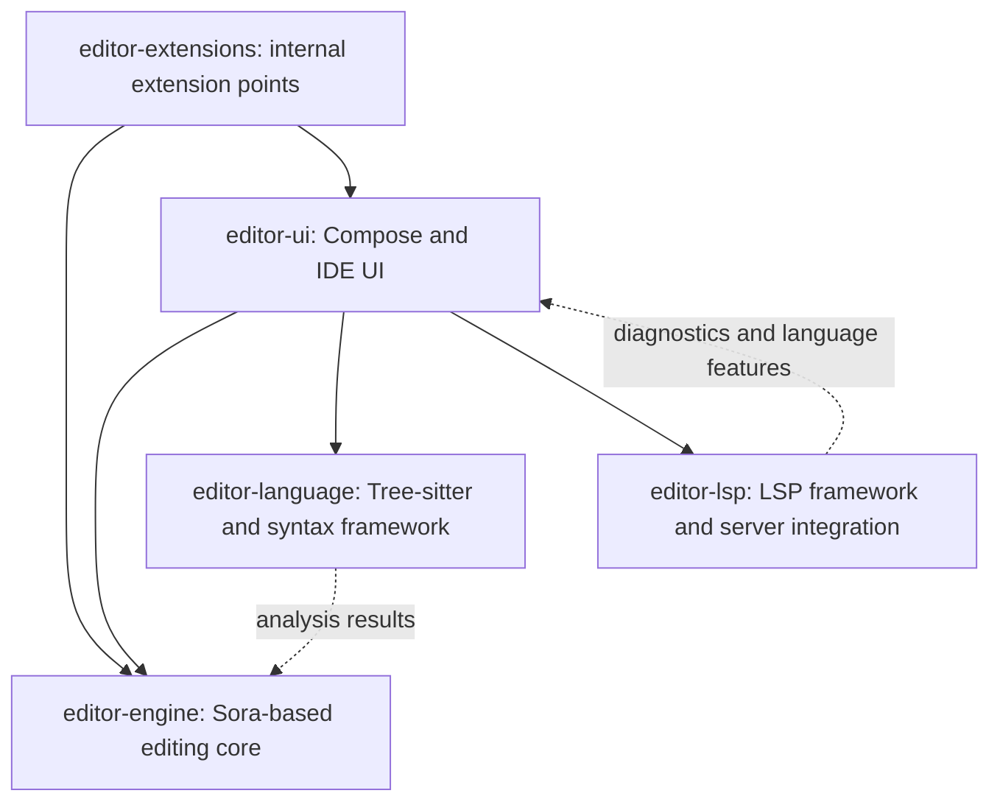

# Editor Core Architecture

## Design direction

Build ZeroStudio's editor by refactoring the Sora Editor core, not by replacing it with a brand-new text engine. The objective is to progressively own the editor architecture and APIs, adapt existing capabilities, and eventually remove the legacy `:editor:impl`.

The architecture uses five coarse Gradle modules. Internal engine concerns remain package-level subsystems unless a concrete independent build/runtime boundary justifies splitting them.

## Module overview

## Ownership boundaries

### editor-engine
Owns the edit session, document operations, selection/cursor state, input/IME behavior, layout and viewport, rendering and decorations, undo/redo, internal event flow, and engine performance/memory behavior. Sora is the initial technical foundation; its internals may be changed, replaced, or removed as the ZeroStudio-owned implementation matures.

### editor-ui
Owns Compose surfaces and IDE-facing UI, including focus/lifecycle, theme, toolbar/context actions and view state. It must not duplicate document storage, editing transactions, undo history, parser implementation or LSP protocol logic.

### editor-language
Owns Tree-sitter integration and syntax framework: parser/query/grammar management, JNI/native integration boundaries, incremental parse scheduling, language registration and highlighting data conversion. Existing language/Tree-sitter modules should be inspected and selectively reused; they are not automatically migrated wholesale.

### editor-lsp
Owns language-server framework changes and integration: protocol/model boundaries, JSON-RPC transport, client/server lifecycle, capability negotiation, document synchronization, requests/notifications/cancellation and language-server feature adapters. The server framework must remain editor-control agnostic.

### editor-extensions
Owns internal extension registration, lifecycle, optional capabilities, commands, key bindings and decorations. Start with statically registered/internal extensions. Dynamic loading, sandboxing and marketplace features are explicitly out of scope until needed.

## Data and event flow

1. User input enters editor-engine through the UI boundary.
2. editor-engine updates the document and selection through its edit model/transactions.
3. Document change events are exposed with revision/position information to language and LSP integrations.
4. editor-language updates parse/highlight data; editor-lsp delivers diagnostics and other asynchronous language features.
5. UI consumes stable editor-facing state and rendering/decorations, not parser or protocol internals.
6. Extensions register optional behavior through explicit contracts; core editing remains usable without them.

## Dependency rules

- editor-engine must not depend on editor-ui, Tree-sitter, LSP, or extension implementations.
- editor-ui depends on editor-engine and may integrate editor-language/editor-lsp via public contracts.
- editor-language depends on engine-facing contracts for document/change information, not private engine classes.
- editor-lsp depends on stable document synchronization/position contracts and protocol abstractions, not the concrete Compose UI.
- editor-extensions integrates through public/internal extension contracts; avoid cycles and core-to-extension dependencies.
- tests are colocated with their owning module.

## Migration strategy

Keep current source modules available while inventorying their code and consumers. Move/refactor in small slices and keep the project buildable. Do not remove old `:editor:impl` before the replacement has feature coverage, migrated consumers, tests and build validation. Preserve Tree-sitter and language-server infrastructure where useful; migrate ownership and interfaces rather than blindly deleting it.

## Non-goals for the initial architecture

- Rewriting text storage from scratch before auditing Sora.
- Creating separate Gradle modules for every editor subsystem.
- Building a plugin marketplace, arbitrary dynamic code loading or sandbox.
- Coupling language analysis or LSP lifecycle to Compose UI.
- Removing existing parser/native/server infrastructure without a dependency audit.
