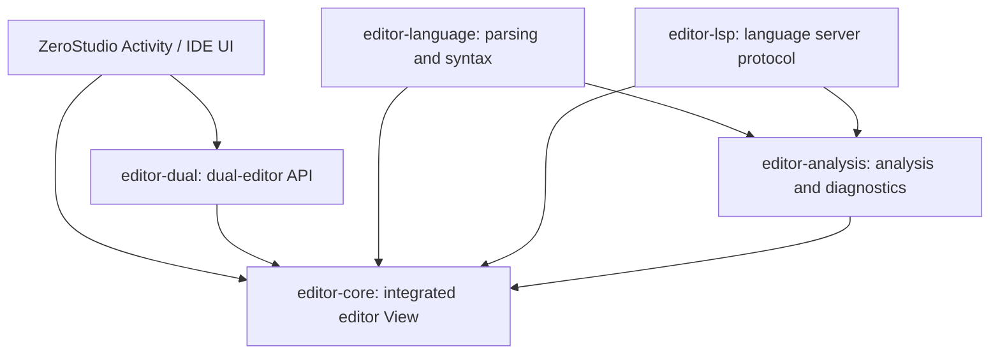

# Editor Core Architecture

## Product boundary

`editor-core` is the integrated code-editor control and editing engine. It exposes a complete Android View that an Activity can host. Activity owns IDE page composition and application UI such as toolbars, tabs, sidebars, panels and navigation. There is no separate `editor-ui` module.

## Module map

The diagram describes integration relationships, not permission for implementation-level cyclic dependencies. Modules must communicate through stable contracts and dependency direction must be verified during implementation.

## Module ownership

### editor-core
Owns the complete editor View and its internal editing systems: text storage and mutation, edit transactions, undo/redo, cursor, selection, keyboard/IME input, layout, measurement, rendering, viewport and scrolling, gutter, folding, clipboard, search/replace, completion interaction, snippet expansion, formatting-result application, decorations, editor state/events and performance safeguards.

It does not own Activity page UI, project/file-browser management, Git repository operations, Tree-sitter implementation or LSP transport. Text/document editing internals remain inside this module rather than being extracted into separate `editor-text` or `editor-document` modules.

### editor-language
Owns language registration/configuration, Tree-sitter integration, parser/tree/node/query lifecycle, grammar and query assets, JNI/native boundaries, incremental parsing, parse scheduling/cancellation, stale-result/version checks, syntax highlighting data and parser memory/large-file safeguards.

### editor-lsp
Owns LSP protocol models, JSON-RPC, transport, client/server lifecycle, server registry/configuration, capability negotiation, workspace/document synchronization, requests/notifications, cancellation, error handling and language-server feature adapters.

### editor-analysis
Owns analysis provider/rule contracts, analysis task scheduling/cancellation, unified diagnostic models, multi-source diagnostic aggregation, severity/filtering, document-position mapping, result caching and document-version/stale-result validation. It can consume Tree-sitter, local analyzers and LSP diagnostics; it does not own their underlying transports or parsers.

### editor-dual
Owns APIs for composing and coordinating two independent editor-core instances: editor pairing, document binding, split direction/ratio configuration, active-editor and focus management, command routing, optional viewport/scroll/cursor synchronization, and comparison-data anchors. It does not calculate diffs, operate Git or own IDE page layout.

## Internal features, not Gradle modules

Text buffer/index, edit transactions, undo/redo, input/IME, cursor, selection, layout, rendering, scrolling, gutter, folding, search/replace, completion interaction, formatting application, snippets, clipboard and decorations remain packages/subsystems within `editor-core`.

## Migration constraints

- Sora Editor remains the technical foundation to audit and refactor; do not replace it with a speculative from-scratch text engine.
- Keep the current legacy editor implementation and existing Tree-sitter/JNI/LSP code until their consumers and responsibilities are mapped.
- Do not create speculative cross-module dependencies in empty bootstrap modules.
- Design stable document/change/version and editor-facing result contracts before connecting language and analysis services.
- `editor-dual` must reuse editor-core instances rather than duplicate the editing engine.
- Remove legacy `:editor:impl` only after consumers, resources, dependencies and tests have migrated and clean builds pass.
