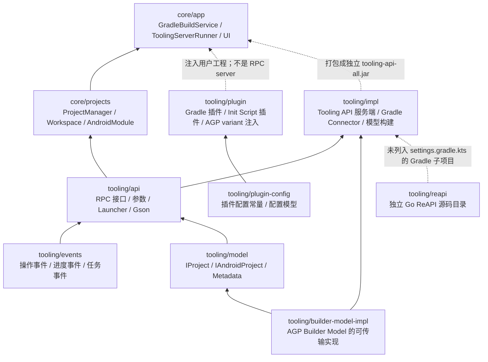
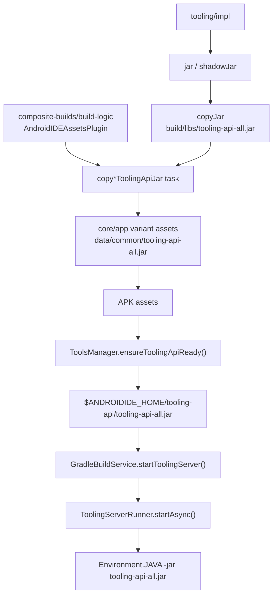
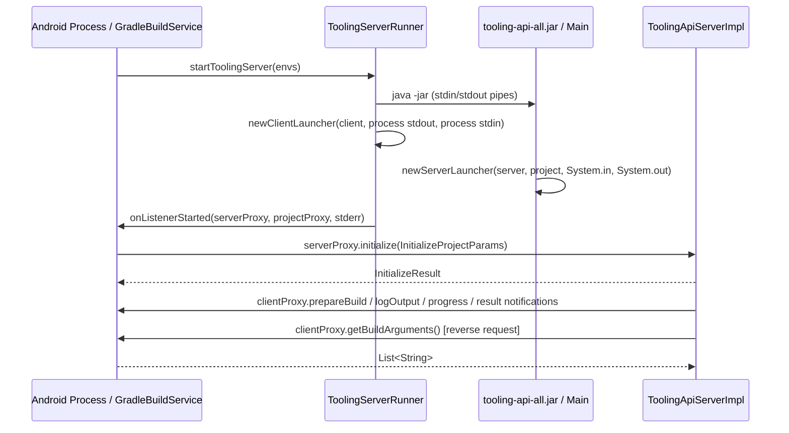
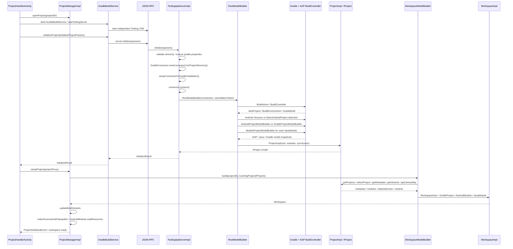
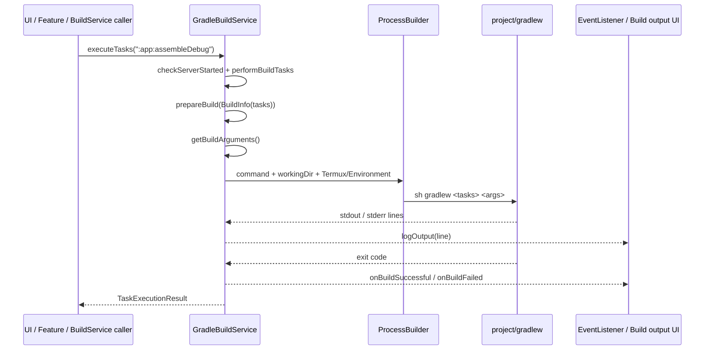
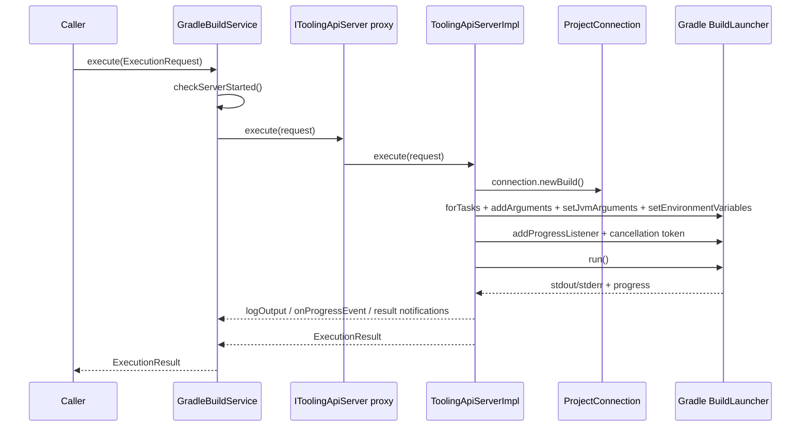
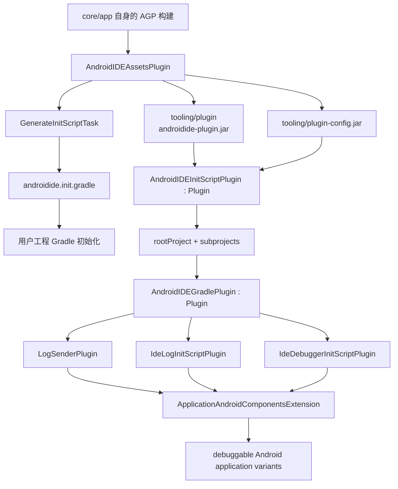

# ZeroStudio Tooling / Gradle / AGP 架构与数据流

> 本文以仓库当前 main 源码为准。编写基线：699ac90df57037f70ba924aba4ce97820c09e5e3。
> 本文区分“APK 自身构建时的 AGP 集成”“IDE 运行时的 Gradle Tooling API 服务”“被打开工程中的 Android Gradle Plugin 模型读取与插件注入”，三者使用了相邻但不同的代码路径。

## 0. 先给出架构结论

1. 仓库中的 Gradle Tooling API 服务端实现位于 tooling/impl；Android 端的服务宿主和进程管理位于 core/app/.../services/builder。
2. core/projects（注意目录是复数，不是 core/project）负责把远端 IProject 模型代理转换成本地 Workspace、GradleProject、AndroidModule、JavaModule，并负责索引和资源模型初始化。
3. AGP 模型读取不是一个单独命名为 AGPService 的 Android Service。实际执行者是 tooling/impl/sync 下的模型构建器：它通过 Gradle Tooling API 的 BuildController 查询 AGP Tooling Models。
4. tooling/plugin 是注入到“用户打开的 Gradle 工程”中的 Gradle 插件；它不是 Tooling API RPC 服务端。它通过 AndroidComponentsExtension 对 Android application variant 做依赖、Manifest placeholder 和生成源码注入。
5. 当前构建入口存在两条不同的执行路径：
   - BuildService.executeTasks(...)：Android 端直接 ProcessBuilder 启动项目的 gradlew。
   - BuildService.execute(ExecutionRequest)：通过 JSON-RPC 调用独立 JVM 中的 ToolingApiServerImpl，再由 Gradle Tooling API 执行。
   两条路径不能混为一谈；GradleDistributionParams 对 Tooling API Connector 路径生效，不会改变 executeTasks() 直接使用项目 gradlew 的行为。
6. Tooling API 服务端作为独立 Java 进程运行。Android Service 与该进程之间用 stdin/stdout 双向承载 LSP4J JSON-RPC；stderr 单独作为服务端日志读取。

## 1. 总体架构方向图

### 1.1 运行时主链路

```mermaid
flowchart LR
  UI["core/app UI<br/>ProjectHandlerActivity / Build UI"]
  BS["core/app<br/>GradleBuildService : Android Service"]
  RUN["core/app<br/>ToolingServerRunner"]
  JAR["tooling-api-all.jar<br/>tooling/impl Shadow JAR"]
  RPC["LSP4J JSON-RPC<br/>stdin / stdout"]
  SERVER["tooling/impl<br/>Main + ToolingApiServerImpl"]
  CONNECTOR["Gradle Tooling API<br/>GradleConnector / ProjectConnection"]
  DAEMON["Gradle Daemon / Build"]
  AGP["AGP Tooling Models<br/>BasicAndroidProject / AndroidProject / VariantDependencies"]
  PROXY["tooling/impl<br/>ProjectImpl / AndroidProjectImpl"]
  CORE["core/projects<br/>WorkspaceModelBuilder"]
  WS["WorkspaceImpl<br/>GradleProject / AndroidModule / JavaModule"]
  EDITOR["Editor / LSP / Indexing / Resource consumers"]

  UI -->|"bindService / BuildService API"| BS
  BS -->|"startToolingServer + Termux env"| RUN
  RUN -->|"java -jar"| JAR
  JAR --> SERVER
  RUN <-->|"process stdin/stdout"| RPC
  RPC <-->|"remote proxies + requests"| SERVER
  SERVER --> CONNECTOR
  CONNECTOR --> DAEMON
  DAEMON --> AGP
  AGP --> PROXY
  PROXY -->|"IProject / IAndroidProject JSON-RPC model calls"| RPC
  RPC -->|"IProject proxy"| BS
  BS -->|"Lookup.KEY_PROJECT_PROXY"| CORE
  CORE --> WS
  WS --> EDITOR
```



### 1.2 三条不同但相互关联的链路

```mermaid
flowchart TB
  subgraph A["A. 工程同步 / AGP 模型链"]
    A1["ProjectHandlerActivity"]
    A2["GradleBuildService.initializeProject"]
    A3["ToolingApiServerImpl.initialize"]
    A4["RootModelBuilder / AndroidProjectModelBuilder"]
    A5["AGP + Gradle Tooling Models"]
    A6["ProjectImpl / IProject proxy"]
    A7["WorkspaceModelBuilder"]
    A8["ProjectManagerImpl.setupProject"]
    A1 --> A2 --> A3 --> A4 --> A5 --> A6 --> A7 --> A8
  end
  subgraph B["B. 普通任务执行链"]
    B1["BuildService.executeTasks"]
    B2["getBuildArguments"]
    B3["ProcessBuilder: sh gradlew <tasks> <args>"]
    B4["stdout/stderr readers"]
    B5["BuildService.EventListener / UI"]
    B1 --> B2 --> B3 --> B4 --> B5
  end
  subgraph C["C. Tooling API 请求执行链"]
    C1["BuildService.execute(ExecutionRequest)"]
    C2["JSON-RPC server.execute"]
    C3["ToolingApiServerImpl.execute"]
    C4["ProjectConnection.newBuild"]
    C5["BuildLauncher.run"]
    C6["ProgressListener / JSON-RPC callback"]
    C1 --> C2 --> C3 --> C4 --> C5 --> C6
  end
```



> 注意：B 与 C 都由 BuildService 对外提供，但内部执行器不同。B 直接创建 gradlew 子进程；C 通过 Tooling API 的 ProjectConnection。服务端 IToolingApiServer.executeTasks(TaskExecutionMessage) 也存在，它同样走 Tooling API BuildLauncher；但 Android 端 BuildService.executeTasks(...) 当前实现并没有转发到该 RPC 方法。

## 2. tooling 目录模块边界与依赖方向

### 2.1 Gradle 模块依赖图



上图是职责与主要编译依赖的概念图，不代表所有传递依赖。更精确的模块依赖以各自 build.gradle.kts 为准。

### 2.2 模块职责表

| 模块 | 主要职责 | 关键源码 / 对外边界 |
|---|---|---|
| tooling/events | Gradle 操作事件的数据类型：Start、Progress、Finish、Status，以及 Task、Configuration、Download、Transform、WorkItem 事件 | tooling/events/src/main/java/com/itsaky/androidide/tooling/events |
| tooling/builder-model-impl | 将 AGP builder-model 接口/对象转换为 IDE 可控、可序列化的 Default* 模型实现 | tooling/builder-model-impl/.../builder/model |
| tooling/model | Tooling API 对外的项目模型契约：IProject、IGradleProject、IAndroidProject、IJavaProject、ProjectMetadata、Variant Metadata、GradleTask 等 | tooling/model/.../tooling/api |
| tooling/api | RPC 双方接口、请求参数和结果、JSON-RPC Launcher、Gson 多态序列化、File 序列化 | IToolingApiClient、IToolingApiServer、ToolingApiLauncher、messages |
| tooling/impl | 独立 JVM 服务端入口、ToolingApiServerImpl、GradleConnector、BuildAction、AGP/Java/Gradle 模型抓取、进度转发、日志转发 | Main.kt、ToolingApiServerImpl.kt、sync、internal、progress |
| tooling/plugin-config | 插件侧共享配置和常量，例如 LogSenderConfig / ToolingConfig | tooling/plugin-config/.../tooling/api |
| tooling/plugin | 注入用户工程的 Gradle 插件：Init Script 插件、AndroidIDEGradlePlugin、LogSender、IDE Log / Debugger runtime 注入 | AndroidIDEInitScriptPlugin.kt、AndroidIDEGradlePlugin.kt、LogSenderPlugin.kt、IdeLogInitScriptPlugin.kt、IdeDebuggerInitScriptPlugin.kt |
| tooling/reapi | 仓库中另有 ReAPI Go 源码目录；当前 settings.gradle.kts 没有将其 include 为 Gradle 子项目 | tooling/reapi |

### 2.3 编译依赖方向（按 build.gradle.kts）

- tooling/events：Java/Kotlin library，事件模型主要依赖 jkotlin。
- tooling/builder-model-impl：公开 AGP builder model 相关依赖；并使用 build-info 等工具模块。
- tooling/model：api 暴露 tooling/builder-model-impl、xml/dom 和 LSP4J JSON-RPC。
- tooling/api：api 暴露 tooling/events、tooling/model、logger、build-info、shared、Gson 和 LSP4J JSON-RPC。
- tooling/impl：api 依赖 tooling/api、tooling/builder-model-impl；实现侧依赖 Gradle Tooling API、build-info、shared、日志等；Shadow 插件生成独立运行 JAR。
- tooling/plugin-config：独立配置模块。
- tooling/plugin：Gradle Plugin Development 模块；依赖 plugin-config、build-info 和编译期 AGP。
- core/projects：Android library；api 依赖 tooling/api、EventBus/EventBus events 等。
- core/app：Android application；依赖 core/projects、tooling/api、tooling/pluginConfig 等。它通过 assets 打包 tooling/impl 的 Shadow JAR，而不是把 tooling/impl 当作普通 app 进程内服务实现。

## 3. 进程、对象和生命周期边界

| 所在位置 | 运行实体 | 职责 | 不应混淆的对象 |
|---|---|---|---|
| Android app 进程 | ProjectHandlerActivity / UI | 打开工程、选择 variant、触发同步/构建、接收状态 | UI Activity 不是 Gradle Tooling API server |
| Android app 进程 | GradleBuildService | Android Service；对外实现 core/projects 的 BuildService，同时实现 IToolingApiClient | 它是服务宿主和 RPC client，不是 Gradle daemon |
| Android app 进程 | ToolingServerRunner | 启动/持有独立 Java 进程，建立 JSON-RPC client launcher，读取 server stderr | Runner 不负责解析 AGP model |
| 独立 Java 进程 | tooling/impl Main | 创建 ToolingApiServerImpl 和 ProjectImpl，建立 JSON-RPC server launcher | 它不是 Android Service |
| Gradle Tooling API 连接 | GradleConnector / ProjectConnection | 连接目标工程、创建 BuildAction/BuildLauncher、管理 cancellation token | ProjectConnection 不是 Workspace |
| Gradle daemon / build JVM | Gradle + AGP | 配置目标工程、运行 AGP、产生 Tooling Models、执行任务 | AGP Tooling Models 是数据模型，不是 Android app Service |
| Android app 进程 | ProjectManagerImpl / WorkspaceImpl | 缓存模型、建立模块对象、索引源码/类路径、读取 Android 资源 | 本地 AndroidModule 不等同于远端 AndroidProjectImpl |

### 3.1 Tooling API JAR 如何进入 APK 并在设备上启动



关键事实：

- tooling/impl/build.gradle.kts 的 Shadow JAR 主类是 com.itsaky.androidide.tooling.impl.Main。
- copyJar 将 *-all.jar 复制/重命名为 tooling-api-all.jar。
- core/app 应用 AndroidIDEAssetsPlugin；它在 Android variant 上注册 copyToolingApiJar 任务，并将该 JAR 加入生成 assets。
- ToolsManager.ensureToolingApiReady() 从 APK assets 的 data/common/tooling-api-all.jar 解压到 Environment.TOOLING_API_JAR；解压后验证 JarFile，再原子移动到目标路径。
- ToolingServerRunner 使用 Environment.JAVA 启动该 JAR；命令行包含 --add-opens java.base/java.lang / java.util / java.io，以及 Logback status listener 属性。
- Runner 工作目录为 HOME；启动环境来自 TermuxShellEnvironment。

### 3.2 Android Service 与 Runner 的绑定关系

- ProjectHandlerActivity.startServices() 绑定 GradleBuildService。
- GradleBuildService.onCreate() 将自身注册到 Lookup 的 BuildService.KEY_BUILD_SERVICE。
- GradleBuildService.startToolingServer() 先检查 tooling-api-all.jar 是否可用，再创建 ToolingServerRunner。
- Runner 创建进程后，把 process.inputStream / process.outputStream 交给 ToolingApiLauncher.newClientLauncher。
- Runner 将 remoteProxy 分别转换为 IToolingApiServer 和 IProject，回调 GradleBuildService.onListenerStarted。
- GradleBuildService 保存 server proxy，并将 project proxy 注册到 Lookup 的 BuildService.KEY_PROJECT_PROXY。
- ProjectHandlerActivity 收到启动回调后请求 metadata()，再发起 initializeProject()。
- stderr 不用于 RPC；GradleBuildService.startServerOutputReader() 独立读取 stderr 并写入服务端日志。

## 4. JSON-RPC 通道与双向参数传输

### 4.1 通道结构



两端不是单向调用：

- Android 端 local service：IToolingApiClient。
- Android 端 remote interfaces：IToolingApiServer、IProject。
- Tooling JVM 端 local services：IToolingApiServer、IProject。
- Tooling JVM 端 remote interface：IToolingApiClient。
- 双方通过 LSP4J Launcher + Gson 编码在 stdin/stdout 上交换 JSON-RPC 消息。
- IToolingApiClient / IToolingApiServer 使用 @JsonSegment；请求方法使用 @JsonRequest，事件回调使用 @JsonNotification。
- ToolingApiLauncher 为 File 注册 FileTypeAdapter；为 ProjectMetadata、AndroidVariantMetadata、Dependency、ProgressEvent、OperationDescriptor、OperationResult 等注册 gsonType 多态适配器。该步骤保证接口类型能够按实际子类型往返传输。

### 4.2 RPC 方法和回调方向

| 方向 | 接口方法 | 类型 | 传输内容 / 用途 |
|---|---|---|---|
| Android → Tooling JVM | metadata() | Request | Tooling server PID 等元信息 |
| Android → Tooling JVM | initialize(params) | Request | 工程路径、Gradle distribution、Android variant 选择 |
| Android → Tooling JVM | isServerInitialized() | Request | 初始化状态 |
| Android → Tooling JVM | getRootProject() | Request | 根项目模型代理 |
| Android → Tooling JVM | executeTasks(message) | Request | Tooling API 任务执行（服务端接口） |
| Android → Tooling JVM | execute(request) | Request | 协议中立的任务/参数/JVM 参数/环境变量/进度类型 |
| Android → Tooling JVM | cancelCurrentBuild() / shutdown() | Request | 取消构建 / 关闭服务 |
| Tooling JVM → Android | getBuildArguments() | Reverse Request | 取得 IDE 侧附加 Gradle 参数 |
| Tooling JVM → Android | checkGradleWrapperAvailability() | Reverse Request | 检查或安装 wrapper |
| Tooling JVM → Android | logMessage() / logOutput() | Notification | 日志和 Gradle 输出 |
| Tooling JVM → Android | prepareBuild() | Notification | 构建即将开始 |
| Tooling JVM → Android | onBuildSuccessful() / onBuildFailed() | Notification | 构建结果 |
| Tooling JVM → Android | onProgressEvent() | Notification | Gradle Tooling API 进度事件 |
| Tooling JVM → Android | IProject / IAndroidProject 查询 | Request | 项目、模块、variant、依赖、source set、classpaths 等模型数据 |

## 5. 工程同步与 AGP 模型读取流程

### 5.1 Activity 到本地 Workspace 的完整同步时序



### 5.2 RootModelBuilder 的分流逻辑

RootModelBuilder 在一次 Gradle BuildAction 中：

1. 读取 IdeaProject；尽力读取 BuildEnvironment 和 GradleBuild。
2. 从 IdeaProject.modules 找到根 IdeaModule，并建立 module name → Gradle project path 的映射。
3. 尝试读取 AGP Versions model；若不可用，则尝试 BasicAndroidProject 作为 Android 项目检测回退。
4. 如果检测为 Android 工程：
   - 读取/检查 AGP 版本；
   - 检查 AGP 与 Gradle 版本兼容性；
   - 使用 AndroidProjectModelBuilder 构建根 Android 模型。
5. 否则使用 GradleProjectModelBuilder 构建普通 Gradle 根项目。
6. 对 IdeaProject 中的每个 IdeaModule 调用 ModuleProjectModelBuilder；由其分流到 AndroidProjectModelBuilder 或 JavaProjectModelBuilder。
7. 将 root model、module models、sync issues 组合成 ProjectImpl 返回。

RootModelBuilder 还会给 Tooling API launcher 加入两个 Gradle project properties：

- android.injected.build.model.v2=true
- android.injected.invoked.from.ide=true

它们通过 ConfigurableLauncher.addArguments("-P<key>=<value>") 传入此次模型构建。

### 5.3 AndroidProjectModelBuilder 的 AGP 模型抓取

AndroidProjectModelBuilder 以一个 IdeaModule 为单位：

1. 根据 InitializeProjectParams.androidParams.variantSelections[projectPath] 查找该模块请求的 variant。
2. 如果没有提供 variant，或请求的 variant 不在 AGP 返回的 variant 列表中，则回退到该模块的第一个 variant。
3. 读取 BasicAndroidProject、AndroidProject、AndroidDsl。
4. 触发/检查模块依赖文件解析。
5. 通过带 ModelBuilderParameter 的 getModelAndLog 请求 VariantDependencies，并设置：
   - variantName = configurationVariant
   - additionalArtifactsInModel = true
   - dontBuildRuntimeClasspath = false
   - unitTest / screenshotTest / androidTest / testFixture 等 runtime classpath 构建标志
6. 尽力读取 ProjectSyncIssues；诊断模型失败时记录 warning，不因此直接丢弃已经得到的主模型。
7. 将模型交给 AndroidProjectImpl。

AndroidProjectImpl 将 AGP 模型转换为 Tooling API 自己的 DTO/Default* 模型，包括：

- variant 名称和 artifact metadata；
- applicationId、生成资源目录、生成源码目录、任务名；
- boot classpaths；
- VariantDependencies 的 compile dependency graph；
- library map；
- main source set；
- lint check jars；
- Java compiler options、namespace、resourcePrefix、viewBinding options 等。

### 5.4 core/projects 的模型落地

- ProjectManagerImpl.setupProject() 接收 IProject proxy。
- WorkspaceModelBuilder.build() 先取 allProjects，再 select root project，并根据 ProjectType 分别转换 Gradle、Android、Java 模型。
- Android 项目转换为 AndroidModule；普通 Java 项目转换为 JavaModule；普通 Gradle 项目转换为 GradleProject。
- 每个 module 的元数据包括 Gradle project path、projectDir、buildDir、build script、tasks。
- AndroidModule 进一步持有 namespace、variants、configuredVariant、mainSourceSet、bootClassPaths、libraries、libraryMap、lintCheckJars、classesJar 等。
- ProjectManagerImpl 更新 variant selections，然后并发执行模块源码/classpath 索引；AndroidModule 还执行 readResources()。
- 完成后通过 ProjectInitializedEvent 通知 app 层。

## 6. 参数传输全景

### 6.1 工程初始化参数

ProjectHandlerActivity.createProjectInitParams() 创建 InitializeProjectParams：

| 字段 | 类型 | 来源 | 接收端 | 作用 |
|---|---|---|---|---|
| directory | String | ProjectManagerImpl.projectDir.absolutePath | ToolingApiServerImpl.initialize | 目标工程根目录绝对路径 |
| gradleDistribution | GradleDistributionParams | Activity 的 gradleDistributionParams | setupConnectorForGradleInstallation | 选择 wrapper、指定 Gradle 安装目录或指定 Gradle 版本 |
| androidParams | AndroidInitializationParams | 当前模块 variant selections | AndroidProjectModelBuilder | 按 Gradle project path 选择 Android variant |

AndroidInitializationParams.variantSelections 是 Map<String, String>：

- key：Gradle project path，例如 :app、:feature:sample。
- value：variant name，例如 debug、release、demoDebug。
- 空 Map 使用 AndroidInitializationParams.DEFAULT；AndroidProjectModelBuilder 会自行选择默认/第一个 variant。
- 这是“模型同步时采用哪个 variant”的输入；任务执行仍由任务字符串决定，例如 :app:assembleDebug。

GradleDistributionParams.type 有三种：

| type | value | ToolingApiServerImpl 行为 |
|---|---|---|
| GRADLE_WRAPPER | 空字符串 | 使用工程 gradle-wrapper.properties 指定的分发 |
| GRADLE_INSTALLATION | Gradle 安装目录 | connector.useInstallation(directory) |
| GRADLE_VERSION | 版本字符串 | connector.useGradleVersion(version) |

### 6.2 任务执行参数

ExecutionRequest 是协议中立的任务执行 DTO：

| 字段 | 类型 | 用途 |
|---|---|---|
| requestId | String | 请求唯一 ID，默认 UUID |
| tasks | List<String> | 要执行的 Gradle task path |
| arguments | List<String> | Gradle 命令行参数 |
| jvmArguments | List<String> | Gradle JVM 参数 |
| environmentVariables | Map<String, String> | 构建进程环境变量 |
| operationTypes | Set<OperationType> | 请求哪些 Gradle 进度事件类型 |

ToolingApiServerImpl.execute(request) 的映射关系：

- tasks → BuildLauncher.forTasks(...)
- arguments → BuildLauncher.addArguments(...)
- jvmArguments → BuildLauncher.setJvmArguments(...)
- environmentVariables → BuildLauncher.setEnvironmentVariables(...)
- operationTypes → 转换为 Gradle OperationType 后 addProgressListener(...)
- cancellation → CancellationTokenSource.token()

TaskExecutionMessage 只有 tasks 列表，是旧的 task-only RPC 请求模型。

### 6.3 Android 端普通 executeTasks() 的参数路径

当前 GradleBuildService.executeTasks(vararg tasks) 不会把 tasks 包装成 TaskExecutionMessage 发给 server。它本地构造：

```text
command = [
  "sh",
  <projectDir>/gradlew,
  <task1>,
  <task2>,
  ...,
  <getBuildArguments() 返回的参数>
]
```

随后：

- ProcessBuilder.directory(projectDir)；
- 合并 TermuxShellEnvironment 的环境变量；
- 合并 Environment.putEnvironment() 的自定义变量；
- 确保 PATH 包含 Environment.BIN_DIR 和 Environment.PREFIX/bin；
- 确保 LD_LIBRARY_PATH 包含 Environment.LIB_DIR；
- 设置 TMPDIR = Environment.TMP_DIR；
- 分别读取 stdout/stderr，逐行调用 logOutput()；
- waitFor() 的 exit code 决定 TaskExecutionResult 成功/失败；
- 最后回调 onBuildSuccessful / onBuildFailed。

getBuildArguments() 当前会按需附加：

- --init-script <initScriptPath>（启用 LogSender 且非 release variant 时）；
- -Pandroid.aapt2FromMavenOverride=<Environment.AAPT2>;
- -P<PROPERTY_LOGSENDER_ENABLED>=true/false；
- 可选 --stacktrace、--info、--debug、--scan；
- 可选 --warning-mode all；
- 可选 --build-cache；
- 可选 --offline。

### 6.4 Tooling API 路径的附加参数

ToolingApiServerImpl 的 initialize / executeTasks / execute 会调用 Main.finalizeLauncher()。该函数统一设置：

- stdin 为 NoOp；
- stdout/stderr 指向 LoggingOutputStream；
- UTF-8 编码、语言和地区 JVM 参数；
- JAVA_TOOL_OPTIONS / GRADLE_OPTS / LANG / LC_ALL；
- 如果服务端启动了本地 HTTP proxy，则设置 http/https proxy host、port 和 useSystemProxies；
- 添加 ForwardingProgressListener；
- 反向调用 IToolingApiClient.getBuildArguments()，将返回值追加到 Gradle launcher。

因此 getBuildArguments() 有两个调用场景：

1. GradleBuildService.executeTasks()：Android 进程本地调用，直接追加到 gradlew 命令。
2. Tooling JVM 的 Main.finalizeLauncher()：通过 JSON-RPC reverse request 调回 Android 端，再追加到 Tooling API launcher。

### 6.5 参数和环境变量传输边界

| 参数/数据 | Android app → Tooling JVM | Tooling JVM → Gradle | 说明 |
|---|---|---|---|
| 工程路径 | InitializeProjectParams.directory | GradleConnector.forProjectDirectory | 只在 initialize 时决定连接目录 |
| Gradle 发行版 | GradleDistributionParams | GradleConnector.useWrapper/useInstallation/useGradleVersion | 不会改变 Android 端 executeTasks() 的直接 gradlew 路径 |
| variant map | AndroidInitializationParams.variantSelections | AndroidProjectModelBuilder 的模型选择逻辑 | 主要影响模型抓取和当前 variant 元数据 |
| tasks | ExecutionRequest.tasks / TaskExecutionMessage.tasks | BuildLauncher.forTasks | Tooling API 请求路径 |
| CLI tasks | BuildService.executeTasks(vararg tasks) | ProcessBuilder command tokens | 直接传给项目 gradlew |
| Gradle args | ExecutionRequest.arguments 或反向 getBuildArguments | BuildLauncher.addArguments | Tooling API 路径 |
| JVM args | ExecutionRequest.jvmArguments | BuildLauncher.setJvmArguments | Tooling API execute(request) 路径 |
| 环境变量 | ExecutionRequest.environmentVariables | BuildLauncher.setEnvironmentVariables | Tooling API execute(request) 路径 |
| Termux 环境 | ToolingServerRunner.startAsync(envs) | Java server process environment | 用于 Tooling JVM 本身 |
| Termux / Environment | GradleBuildService.executeTasks() | ProcessBuilder.environment | 用于直接 gradlew 子进程 |
| progress types | ExecutionRequest.operationTypes | Gradle OperationType listener | 通过 ProgressEvent 回传 |

## 7. 构建执行的三种入口必须区分

### 7.1 入口一：BuildService.executeTasks() —— 当前 Android 端直接 gradlew



这是当前 Compose Preview、DebugProjectAction、QuickRun 等调用 BuildService.executeTasks() 时使用的入口。

需要特别注意：该方法开头仍要求 Tooling API server 已启动（checkServerStarted），但真正的 gradle task 由本地 ProcessBuilder 执行。这意味着“Tooling server 已启动”是当前服务门槛，不等于任务本身由 ToolingApiServerImpl 执行。

### 7.2 入口二：BuildService.execute(ExecutionRequest) —— Tooling API BuildLauncher



### 7.3 入口三：IToolingApiServer.executeTasks(TaskExecutionMessage) —— 服务端兼容入口

该 RPC 方法在 IToolingApiServer 和 ToolingApiServerImpl 中保留。服务端同样通过 ProjectConnection.newBuild()、BuildLauncher.forTasks() 和 BuildLauncher.run() 执行。它与 Android 端 BuildService.executeTasks() 同名但不是同一实现路径。

### 7.4 当前执行入口差异

| 维度 | BuildService.executeTasks | BuildService.execute(request) | IToolingApiServer.executeTasks |
|---|---|---|---|
| 任务执行位置 | Android 进程创建 gradlew 子进程 | 独立 Tooling JVM 内的 Tooling API | 独立 Tooling JVM 内的 Tooling API |
| 入口参数 | String... tasks | ExecutionRequest | TaskExecutionMessage |
| Gradle 分发选择 | 项目 gradlew | Initialize 时的 GradleConnector distribution | Initialize 时的 GradleConnector distribution |
| Gradle arguments | getBuildArguments() 本地拼接 | request.arguments + getBuildArguments() | getBuildArguments() |
| JVM arguments | 由 wrapper/gradle.properties/环境控制 | request.jvmArguments + Main.finalizeLauncher | Main.finalizeLauncher |
| environment | TermuxShellEnvironment + Environment + PATH/LD/TMPDIR | request.environmentVariables + Main.finalizeLauncher | Main.finalizeLauncher |
| progress | 当前实现主要逐行读取 stdout/stderr | Tooling API ProgressListener | Tooling API ProgressListener |
| 取消 | Service 同时触发 server cancellation、pkill 和当前 Process.destroy | Tooling API cancellation token | Tooling API cancellation token |

## 8. 用户工程中的 Init Script 与 AGP 插件注入

这条路径负责在“用户打开的 Android 工程”中应用 ZeroStudio/AndroidIDE 插件能力。它不是前述 JSON-RPC server 的启动入口。

### 8.1 注入和执行方向图



### 8.2 具体插件职责

- GenerateInitScriptTask：生成 data/common/androidide.init.gradle。脚本的 initscript classpath 加载 androidide-plugin 和 plugin-config，然后 apply AndroidIDEInitScriptPlugin。
- AndroidIDEInitScriptPlugin（Plugin<Gradle>）：初始化 UTF-8；配置 pluginManagement / dependencyResolutionManagement / buildscript repositories；在 projectsLoaded 后对 rootProject 和 subprojects 应用 BuildInfo.PACKAGE_NAME 对应的 AndroidIDEGradlePlugin。
- AndroidIDEGradlePlugin（Plugin<Project>）：检查 PROPERTY_LOGSENDER_ENABLED；只对 com.android.application 项目应用 LogSenderPlugin、IdeLogInitScriptPlugin、IdeDebuggerInitScriptPlugin。
- LogSenderPlugin：通过 ApplicationAndroidComponentsExtension.beforeVariants/onVariants 找 debuggable variants，并添加 logsender runtime dependency。
- IdeLogInitScriptPlugin：对 debuggable Android application variant 注入 ide-log-plugin AAR。
- IdeDebuggerInitScriptPlugin：对 debuggable Android application variant 注入 ide-log-plugin / ide-debugger-host runtime artifact，写入 Manifest placeholders，并注册 IdeDebuggerBootstrap.kt 生成任务及编译依赖。

### 8.3 AGP API 在此处的作用

插件侧直接使用 ApplicationAndroidComponentsExtension：

- beforeVariants：筛选 debuggable variant。
- onVariants：针对已创建 variant 注册配置。
- variant runtime configuration：把 runtime AAR 依赖加入目标 variant。
- Manifest placeholder：向目标 app manifest 合并链路提供占位符。
- generated source：生成 IDE debugger bootstrap Kotlin 源码，并将生成目录接入对应 source set/编译任务。

这属于“构建目标工程时修改 AGP variant 配置”的扩展点；与同步时通过 BuildController 读取 AGP Tooling Models 是两种不同的 AGP 集成方式。

## 9. 进度、日志、结果和取消的回传

### 9.1 输出/进度回传


- Tooling API 服务端的 Gradle 输出通过 LoggingOutputStream 转成 logOutput(line) 通知。
- Tooling API 的 OperationProgressListener 经 ForwardingProgressListener 转成 tooling/events 中的 ProgressEvent，再通过 onProgressEvent 通知 Android 端。
- GradleBuildService 将事件交给 EventListener，并通过 runOnUiThread 转发 UI 回调。
- 直接 gradlew 路径由 Android 端分别读取 Process.inputStream / errorStream，逐行转发 logOutput。

### 9.2 取消和关闭

- ToolingApiServerImpl.cancelCurrentBuild() 使用 CancellationTokenSource.cancel()。
- ToolingApiServerImpl.shutdown() 关闭 ProjectConnection、断开 GradleConnector、关闭 DefaultGradleConnector、停止本地 HTTP proxy、清理状态并结束 Main 的监听 future。
- GradleBuildService.cancelCurrentBuild() 请求 server cancellation，并在延迟后执行 pkill -f gradlew 和 currentBuildProcess.destroy()。
- GradleBuildService.cleanupIdleResources() 会先清理 daemon / gradlew；trigger != post-build 时才关闭 Tooling API server 和 Runner。
- post-build cleanup 特意保留 Tooling API server，以免编辑器与 Compose Preview 共用的服务被提前关闭。
- Service onDestroy() 会取消待处理请求、停止输出读取任务、关闭 server/runner，并处理残留 gradlew 进程。

## 10. 当前架构中的关键边界与容易误判处

1. core/projects 是项目模型层，不负责启动 Gradle JVM。它消费 IProject proxy 并构造 Workspace。
2. core/app 的 GradleBuildService 是 Android Service；ToolingServerRunner 才负责拉起独立 Java server 进程。
3. tooling/impl 是 RPC server + Gradle Tooling API client（它作为 Gradle Connector 的调用方），并非 Gradle daemon 本身。
4. Gradle daemon 才真正配置用户工程、加载 AGP 插件、构建 AGP 模型或执行任务。
5. tooling/plugin 是被用户工程加载的 Gradle 插件；tooling/api 是进程间协议和 DTO；tooling/impl 是服务端实现。三者职责不同。
6. AGP 模型读取路径使用 BuildController.getModel/findModel；AGP variant 插件注入路径使用 ApplicationAndroidComponentsExtension.beforeVariants/onVariants。不要将两者当作同一个 API 层。
7. AndroidInitializationParams 的 variantSelections 用于模型读取阶段选择 variant；它本身不等价于 assemble task。
8. BuildService.executeTasks() 与 BuildService.execute(ExecutionRequest) 使用不同执行后端。若后续要统一构建服务，需要先明确分层、取消、日志、环境、JVM 参数和 Gradle distribution 的兼容语义，不能只改方法名或代理层。
9. GradleBuildService.executeTasks() 当前要求 Tooling API server 已启动，但 task 实际通过本地 gradlew 运行。这是当前实现的门槛/执行器分离点。
10. GradleDistributionParams 通过 GradleConnector 选择分发；直接 ProcessBuilder 路径使用项目目录下的 gradlew。两条路径的 Gradle 版本来源可能不同。
11. ToolingApiLauncher 的 Gson 多态注册和 FileTypeAdapter 是协议组成部分。新增 RPC DTO / ProgressEvent 子类时，需要检查序列化类型注册是否同步更新。
12. tooling/reapi 虽然位于 tooling/ 下，但当前 settings.gradle.kts 未 include :tooling:reapi；不能仅因目录位置就把它归入上述 Kotlin Tooling API 服务进程。

## 11. 关键源码导航

### Android app / Service / 项目工作区

- core/app/src/main/java/com/itsaky/androidide/activities/editor/ProjectHandlerActivity.kt
- core/app/src/main/java/com/itsaky/androidide/services/builder/GradleBuildService.kt
- core/app/src/main/java/com/itsaky/androidide/services/builder/ToolingServerRunner.kt
- core/app/src/main/java/com/itsaky/androidide/services/builder/GradleBuildServiceConnnection.kt
- core/app/src/main/java/com/itsaky/androidide/services/builder/GradleServiceBinder.kt
- core/projects/src/main/java/com/itsaky/androidide/projects/builder/BuildService.kt
- core/projects/src/main/java/com/itsaky/androidide/projects/internal/ProjectManagerImpl.kt
- core/projects/src/main/java/com/itsaky/androidide/projects/internal/WorkspaceModelBuilder.kt
- core/projects/src/main/java/com/itsaky/androidide/projects/internal/WorkspaceImpl.kt
- core/projects/src/main/java/com/itsaky/androidide/projects/android/AndroidModule.kt

### Tooling protocol / model / runtime

- tooling/api/src/main/java/com/itsaky/androidide/tooling/api/IToolingApiClient.kt
- tooling/api/src/main/java/com/itsaky/androidide/tooling/api/IToolingApiServer.kt
- tooling/api/src/main/java/com/itsaky/androidide/tooling/api/util/ToolingApiLauncher.kt
- tooling/api/src/main/java/com/itsaky/androidide/tooling/api/messages/InitializeProjectParams.kt
- tooling/api/src/main/java/com/itsaky/androidide/tooling/api/messages/AndroidInitializationParams.kt
- tooling/api/src/main/java/com/itsaky/androidide/tooling/api/messages/ExecutionRequest.kt
- tooling/impl/src/main/java/com/itsaky/androidide/tooling/impl/Main.kt
- tooling/impl/src/main/java/com/itsaky/androidide/tooling/impl/ToolingApiServerImpl.kt
- tooling/impl/src/main/java/com/itsaky/androidide/tooling/impl/internal/ProjectImpl.kt
- tooling/impl/src/main/java/com/itsaky/androidide/tooling/impl/internal/AndroidProjectImpl.kt
- tooling/impl/src/main/java/com/itsaky/androidide/tooling/impl/sync/RootModelBuilder.kt
- tooling/impl/src/main/java/com/itsaky/androidide/tooling/impl/sync/AndroidProjectModelBuilder.kt
- tooling/impl/src/main/java/com/itsaky/androidide/tooling/impl/sync/ModuleProjectModelBuilder.kt
- tooling/model/src/main/java/com/itsaky/androidide/tooling/api/IAndroidProject.kt
- tooling/builder-model-impl/src/main/java/com/itsaky/androidide/builder/model

### Gradle plugin / AGP variant injection / packaging

- tooling/plugin/src/main/java/com/itsaky/androidide/gradle/AndroidIDEInitScriptPlugin.kt
- tooling/plugin/src/main/java/com/itsaky/androidide/gradle/AndroidIDEGradlePlugin.kt
- tooling/plugin/src/main/java/com/itsaky/androidide/gradle/LogSenderPlugin.kt
- tooling/plugin/src/main/java/com/itsaky/androidide/gradle/IdeLogInitScriptPlugin.kt
- tooling/plugin/src/main/java/com/itsaky/androidide/gradle/IdeDebuggerInitScriptPlugin.kt
- tooling/plugin-config/src/main/java/com/itsaky/androidide/tooling/api
- composite-builds/build-logic/plugins/src/main/java/com/itsaky/androidide/plugins/AndroidIDEAssetsPlugin.kt
- composite-builds/build-logic/plugins/src/main/java/com/itsaky/androidide/plugins/tasks/GenerateInitScriptTask.kt
- core/common/src/main/java/com/itsaky/androidide/managers/ToolsManager.java
- core/common/src/main/java/com/itsaky/androidide/utils/Environment.java

### Gradle module wiring

- settings.gradle.kts：include tooling 子模块、core/projects、core/app。
- tooling/*/build.gradle.kts：各 tooling 子模块编译依赖。
- tooling/impl/build.gradle.kts：Shadow JAR 打包和主类。
- tooling/plugin/build.gradle.kts：Gradle plugin IDs 和 implementation classes。
- core/projects/build.gradle.kts：core/projects 对 tooling/api 的依赖。
- core/app/build.gradle.kts：app 对 core/projects、tooling/api、plugin-config 的依赖。
- composite-builds/build-logic/plugins/.../AndroidIDEAssetsPlugin.kt：将 tooling-api-all.jar 和 init script 等生成物放入 APK assets。

## 12. 名词对照

| 名称 | 含义 |
|---|---|
| Gradle Tooling API | Gradle 提供的客户端 API；用于连接工程、请求模型、执行 BuildLauncher/BuildAction |
| GradleConnector | 创建 Tooling API ProjectConnection 的入口 |
| ProjectConnection | 已连接的 Gradle 工程会话 |
| BuildController | BuildAction 内用于查询 Gradle/AGP Tooling Models 的控制器 |
| AGP Tooling Model | AGP 对外提供的 Android 工程/variant/dependency 等模型 |
| AndroidComponentsExtension | AGP 插件扩展点，用于配置 variant 生命周期和 artifacts |
| ToolingApiServerImpl | ZeroStudio 自己实现的 Tooling API RPC server 端业务类 |
| ToolingServerRunner | Android 端独立 Java 进程启动器和 JSON-RPC client |
| IProject | RPC 暴露的根项目/模块选择和项目模型接口 |
| WorkspaceImpl | Android app 侧缓存的本地项目工作区 |
| AndroidModule | core/projects 侧的本地 Android 模块模型 |
| tooling/plugin | 加载到用户工程 Gradle 构建中的 Gradle 插件，不是 Tooling API server |
| tooling-api-all.jar | tooling/impl Shadow JAR，运行时作为独立 JVM 进程入口 |

---

本文描述的是当前源码中的实现关系和参数流，不代表所有执行路径已统一，也不代表未来重构目标。涉及执行器切换、RPC 协议变更、AGP API 兼容性或进程生命周期的修改，应先对照本文中的对应链路和源码入口同步更新架构图。
