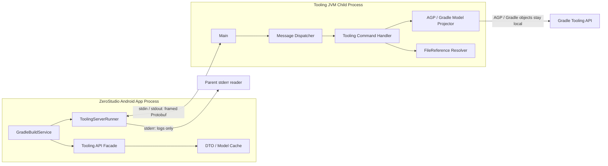
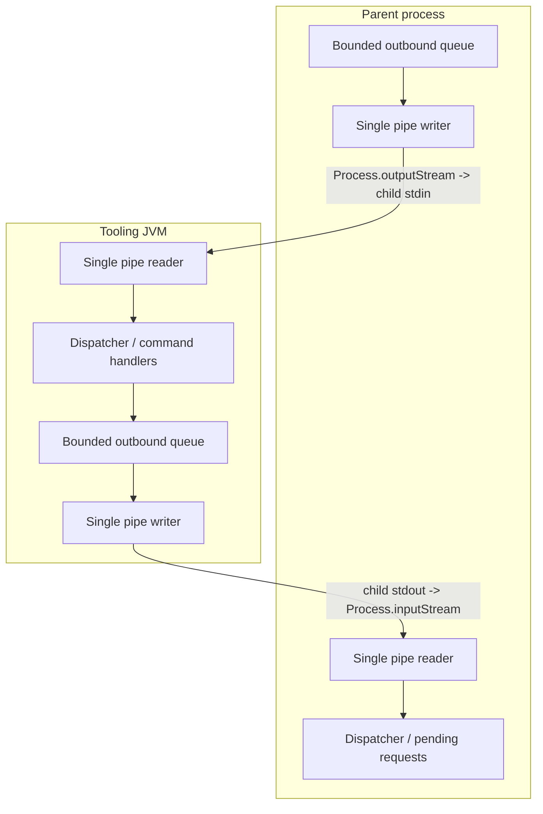
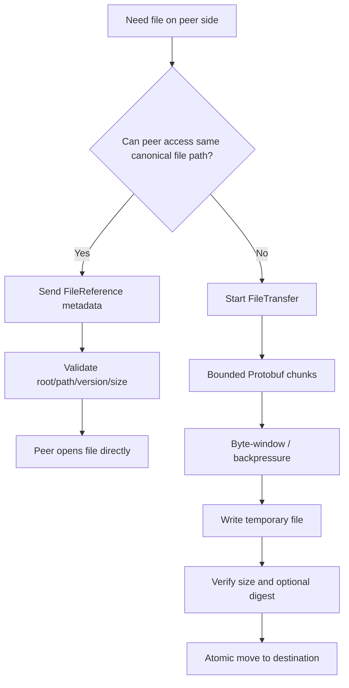
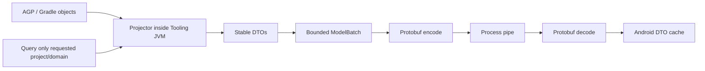
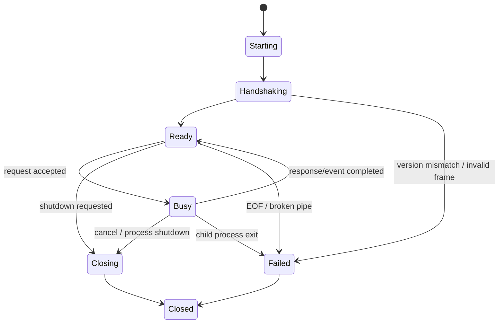

# 架构图与时序图

## 1. 进程拓扑



## 2. 双向管道与线程模型



## 3. 消息生命周期

```mermaid
sequenceDiagram
  participant A as Android parent
  participant W as Parent writer
  participant R as Tooling reader
  participant H as Tooling handler
  participant G as Gradle/AGP model
  participant C as Tooling writer

  A->>W: Command(request_id)
  W->>R: length + Protobuf Envelope
  R->>H: decoded command
  H->>G: query / execute
  G-->>H: result or model data
  H->>C: Response / ModelBatch
  C-->>A: framed Protobuf
  Note over A,C: request_id correlates response; no generic remote object proxy
```

## 4. 文件路径选择



## 5. 模型投影与分批



## 6. 失败处理


